# 01. Линейная регрессия

[Главная страница](../../README.md) · [Практическая работа №1](../README.md) · [Ноутбук с кодом и результатами](01_%D0%9B%D0%B8%D0%BD%D0%B5%D0%B9%D0%BD%D0%B0%D1%8F_%D1%80%D0%B5%D0%B3%D1%80%D0%B5%D1%81%D1%81%D0%B8%D1%8F_Auto_MPG.ipynb)

## Описание работы

**Набор данных:** Auto MPG. Прогноз топливной экономичности автомобиля.

Были выполнены проверка и подготовка данных, разведочный анализ, обучение модели и оценка на тестовой выборке.

**Источники данных:** [1](https://raw.githubusercontent.com/mwaskom/seaborn-data/master/mpg.csv)

## Содержание

[Результаты и метрики](#results) · [Графики](#figures) · [Выводы](#conclusions)

## Результаты и метрики

Количество объектов в тестовой выборке: **79**.

| Метрика | Значение |
|---|---:|
| MAE | 2.462 |
| RMSE | 3.256 |
| R² | 0.792 |

## Графики

- [1. Диаграммы размаха числовых признаков](#figure-01)
- [2. Распределения числовых признаков](#figure-02)
- [3. Зависимость MPG от веса автомобиля](#figure-03)
- [4. Зависимость MPG от мощности](#figure-04)
- [5. Матрица корреляции](#figure-05)
- [6. Скрипичная диаграмма: распределение MPG по регионам](#figure-06)
- [7. Шестиугольная карта плотности: масса и MPG](#figure-07)
- [8. Линейный график: средняя экономичность по модельным годам](#figure-08)
- [9. Групповой boxplot: MPG по числу цилиндров](#figure-09)
- [10. Фактические и предсказанные значения](#figure-10)
- [11. Остатки модели](#figure-11)
- [12. Гистограмма и KDE: распределение остатков модели](#figure-12)
- [13. Нормальный Q–Q график остатков](#figure-13)
- [14. Сравнение средней ошибки модели по регионам](#figure-14)
- [15. Эмпирическая функция распределения абсолютной ошибки (ECDF)](#figure-15)

### Рисунок 1. Диаграммы размаха числовых признаков

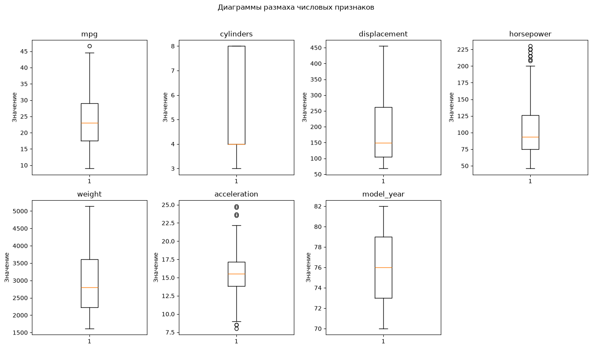

Для каждого числового признака построен отдельный boxplot, поэтому признаки с разными масштабами не мешают друг другу. Коробка показывает промежуток между первым и третьим квартилями, линия внутри коробки — медиану, «усы» — основной диапазон значений, а отдельные точки за усами являются потенциальными выбросами.

График помогает заметить необычно большие или маленькие значения. Такие точки не удаляются автоматически: например, автомобиль действительно может иметь необычно высокую мощность или массу. Перед исключением таких наблюдений необходимо проверить, являются ли они ошибками измерения.

Диаграммы построены раздельно, поскольку вес автомобиля измеряется тысячами фунтов, а другие признаки имеют значительно меньшие масштабы. Общая ось Y скрыла бы их разброс.

### Рисунок 2. Распределения числовых признаков

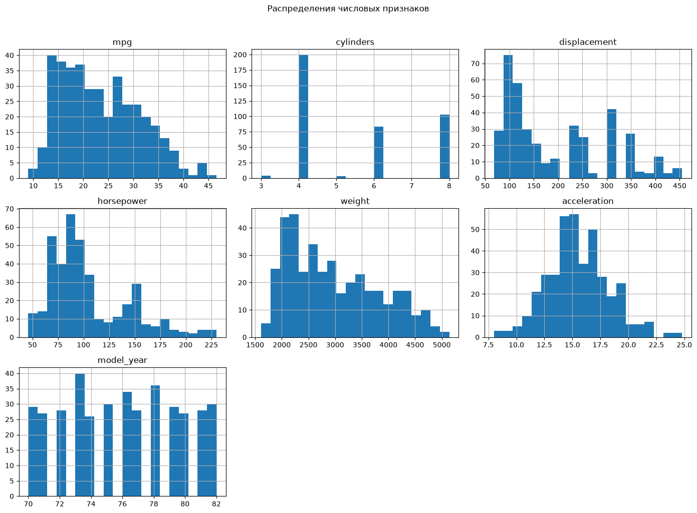

Каждый небольшой график — гистограмма одного признака. По горизонтали отложены значения признака, по вертикали — сколько автомобилей попало в соответствующий интервал.

По форме гистограммы можно увидеть, где находится основная масса наблюдений, есть ли перекос распределения, несколько групп значений или длинные «хвосты».

Перед обучением модели важно понимать структуру данных и замечать необычные распределения.

### Рисунок 3. Зависимость MPG от веса автомобиля

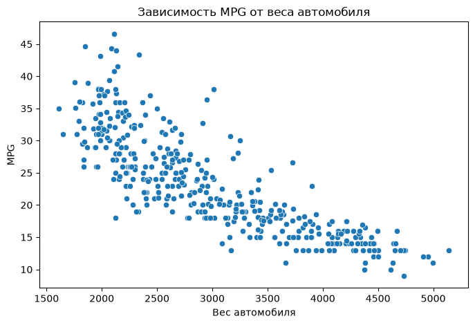

Каждая точка — один автомобиль. По оси X указан вес, по оси Y — его `mpg`.

Облако точек имеет выраженное направление вниз: при увеличении веса `mpg` обычно уменьшается.

Между весом и топливной экономичностью наблюдается заметная отрицательная связь, поэтому `weight` является полезным признаком для линейной регрессии.

На диаграмме показана связь, а не доказанная причинная зависимость. На экономичность могут влиять и другие характеристики автомобиля.

### Рисунок 4. Зависимость MPG от мощности

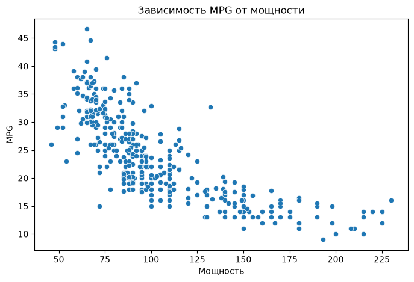

Каждая точка — автомобиль. По оси X расположена мощность двигателя, по оси Y — `mpg`.

В среднем более мощные автомобили имеют меньший `mpg`, то есть расходуют больше топлива на одну милю пробега.

`horsepower` также имеет заметную отрицательную связь с целевой переменной.

Для интерпретации учитывается, что мощность связана с массой и объёмом двигателя, поэтому влияние одного признака нельзя полностью отделить по двумерному графику.

### Рисунок 5. Матрица корреляции

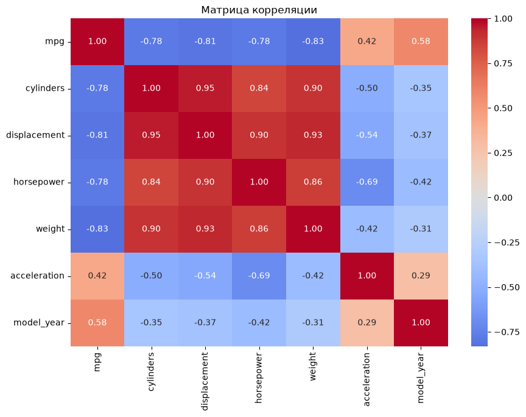

Матрица корреляции отражает силу линейной связи между каждой парой числовых признаков. Значения находятся в диапазоне от `-1` до `1`.

- значение близко к `1` — сильная положительная связь;
- близко к `-1` — сильная отрицательная связь;
- около `0` — выраженной линейной связи почти нет.

На главной диагонали всегда стоит `1`, потому что каждый признак полностью коррелирует сам с собой.

Для линейной регрессии особенно полезно увидеть, какие признаки сильнее связаны с `mpg`, а также какие входные признаки сильно коррелируют между собой.

Коэффициенты корреляции рассчитаны по очищенным числовым признакам. Сильная корреляция между двумя входными параметрами может осложнять интерпретацию отдельных коэффициентов регрессии.

### Рисунок 6. Скрипичная диаграмма: распределение MPG по регионам

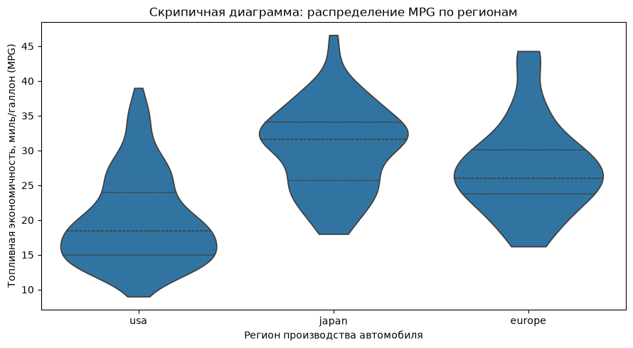

Была построена скрипичная диаграмма (*violin plot*). `sns.violinplot` строит сглаженную плотность распределения в каждой категории, `inner="quartile"` отображает квартильные линии, а `cut=0` не продолжает плотность за наблюдаемый диапазон.

По оси X показан регион (`usa`, `europe`, `japan`), по Y — MPG. Чем шире силуэт на определённой высоте, тем больше там относительная концентрация автомобилей. Линии внутри показывают квартильные ориентиры.

Группы могут различаться по распределению MPG. Это **описательное сравнение**, а не доказательство, что страна производства сама по себе вызывает изменение расхода: на него также влияют масса, мощность, год и другие факторы.

### Рисунок 7. Шестиугольная карта плотности: масса и MPG

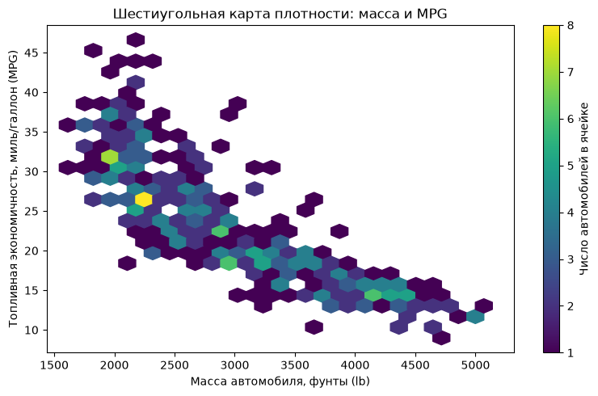

Была построена двумерная диаграмма частот (*hexbin plot*). `plt.hexbin` разбивает плоскость «масса–MPG» на шестиугольные ячейки; цвет показывает, сколько автомобилей попало в ячейку. `mincnt=1` скрывает пустые области.

По X — масса в фунтах, по Y — MPG, цветовая шкала — количество машин. В отличие от обычного scatter, здесь легче увидеть наиболее населённые области, даже если многие точки перекрываются.

Если более тяжёлые автомобили сосредоточены при меньшем MPG, это поддерживает наблюдение об отрицательной статистической связи. График не даёт причинного вывода.

### Рисунок 8. Линейный график: средняя экономичность по модельным годам

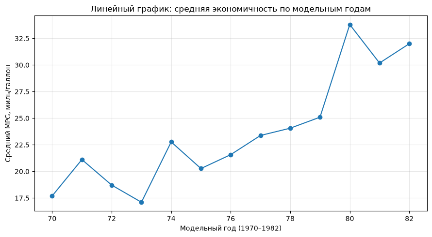

Был построен линейный график (*line plot*) агрегированных данных. `groupby("model_year").mean()` рассчитывает среднее MPG отдельно для каждого модельного года; `plt.plot` соединяет точки в хронологическом порядке.

По X — модельный год, по Y — среднее MPG автомобилей этого года в датасете. Наклон линии отражает изменение групповых средних, **не прогноз отдельного автомобиля**.

Если линия повышается, автомобили более поздних модельных годов в данной выборке в среднем экономичнее. Это не доказывает, что сам год является причиной: одновременно меняются конструкции и состав выборки.

### Рисунок 9. Групповой boxplot: MPG по числу цилиндров

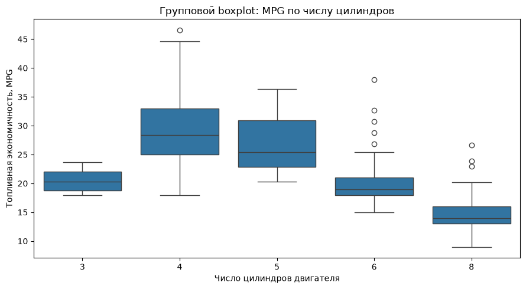

Были построены групповые диаграммы размаха (*grouped boxplots*). `sns.boxplot` строит распределение MPG отдельно для каждой категории числа цилиндров, а `order` упорядочивает категории.

X — число цилиндров, Y — MPG; линия в каждой коробке — медиана, края — квартили, точки вне усов — потенциальные выбросы.

Различия медиан показывают различия центральных значений между группами. Перекрытие коробок означает, что группы не разделяются однозначно. Сам график не доказывает причинного влияния цилиндров.

### Рисунок 10. Фактические и предсказанные значения

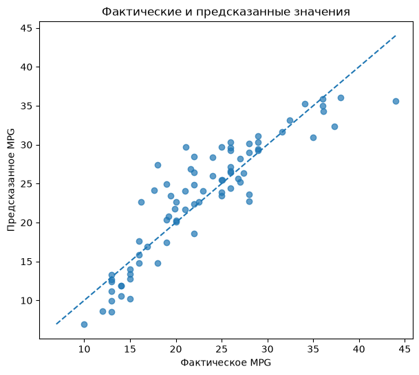

По оси X находятся реальные значения `mpg`, а по оси Y — прогнозы модели. Пунктирная диагональ соответствует идеальному прогнозу, где предсказание полностью совпадает с фактом.

Чем ближе точки к диагонали, тем точнее работает модель. Точки далеко от линии — случаи с большой ошибкой.

Линия равенства задаёт условие идеального прогноза. Расстояние точки от линии по вертикали показывает величину ошибки для соответствующего автомобиля.

### Рисунок 11. Остатки модели

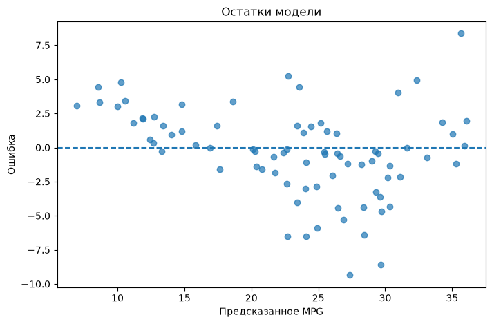

Остаток — это `фактическое значение − предсказание`. Горизонтальная пунктирная линия соответствует нулевой ошибке.

Точки выше нуля означают, что модель занизила MPG; ниже нуля — завысила. Для хорошей линейной модели желательно видеть примерно случайное облако точек вокруг нуля без выраженного рисунка.

Наличие устойчивого изгиба или увеличения разброса при росте прогноза означало бы, что простой линейной формулы недостаточно для описания всей структуры ошибок.

### Рисунок 12. Гистограмма и KDE: распределение остатков модели

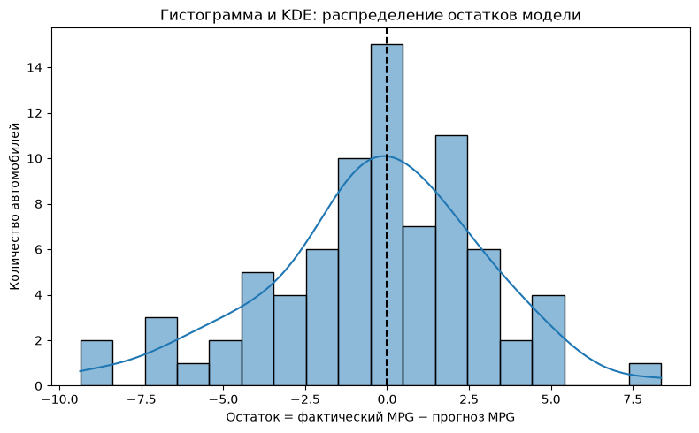

Для сравнения использован график: гистограмма остатков с оценкой плотности (*histogram + kernel density estimate, KDE*). `sns.histplot(..., kde=True)` рисует частоты ошибок и сглаженную форму распределения, вертикальная линия отмечает нулевую ошибку.

X — подписанная ошибка в MPG, Y — число автомобилей в интервале. Центрирование вокруг нуля означает отсутствие сильного среднего смещения, широкие хвосты — наличие крупных ошибок.

Асимметрия или тяжёлые хвосты — повод подробнее изучить ограничения модели. KDE — лишь сглаженное описание данных, а не доказательство нормальности.

### Рисунок 13. Нормальный Q–Q график остатков

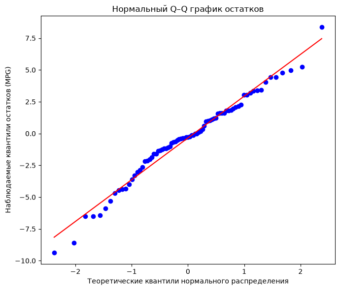

Для сравнения использован график: квантиль-квантильная диаграмма (*normal Q–Q plot*). `stats.probplot` сравнивает упорядоченные остатки с квантилями теоретического нормального распределения и строит линию сравнения.

X — ожидаемые квантили нормального распределения, Y — квантили реальных ошибок. Если точки примерно вдоль прямой, нормальная модель распределения остатков выглядит правдоподобнее.

Заметный изгиб или сильные отклонения на краях указывают на ненормальные хвосты или асимметрию. **Для получения прогнозов методом OLS нормальность остатков не обязательна**; эта проверка важнее для классических статистических предположений и интервалов.

### Рисунок 14. Сравнение средней ошибки модели по регионам

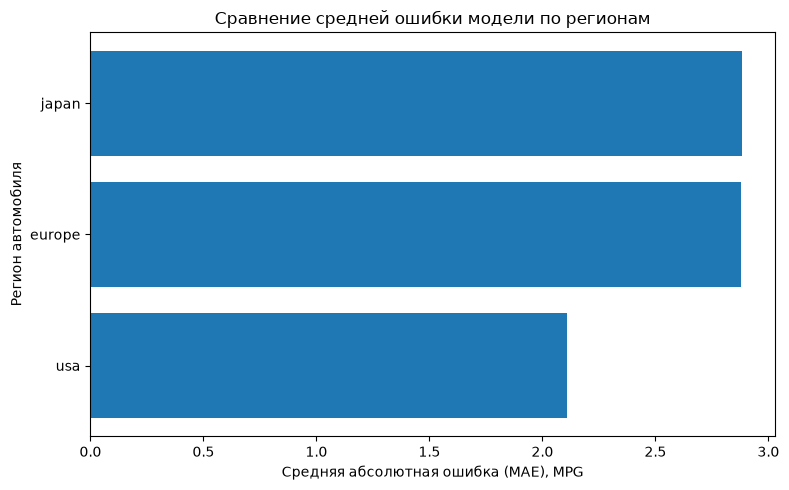

Для сравнения использован график: горизонтальная столбчатая диаграмма (*horizontal bar chart*). `df.loc[y_test.index]` восстанавливает регион каждого **тестового** автомобиля, `abs` считает абсолютную ошибку, `groupby(...).mean()` — её среднее по регионам.

Длина каждого столбца — средняя абсолютная ошибка в MPG среди автомобилей данной группы **в тестовой выборке**. Меньше — точнее.

Различия помогают обнаружить неодинаковую точность в подгруппах. При малом числе тестовых машин в группе оценка может быть нестабильной; это описание, а не основание утверждать о системной дискриминации.

### Рисунок 15. Эмпирическая функция распределения абсолютной ошибки (ECDF)

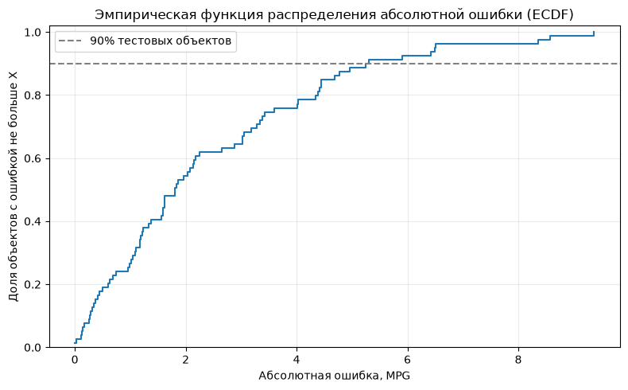

Была построена эмпирическая функция распределения (*empirical cumulative distribution function, ECDF*). `np.sort` упорядочивает абсолютные ошибки, а `np.arange/n` вычисляет накопленную долю тестовых объектов.

X — величина абсолютной ошибки в MPG, Y — доля автомобилей с ошибкой **не больше** этой величины. Например, точка на уровне `0.9` показывает порог ошибки, в который укладываются 90% тестовых наблюдений.

Кривая, растущая ближе к левому краю, означает более частые небольшие ошибки. Пунктир 90% помогает оценить типичный верхний порог ошибок, а не среднее MAE.

## Выводы

Средняя абсолютная ошибка на тестовой выборке составила 2.462 MPG, RMSE — 3.256 MPG. R² = 0.792. Модель по квадратичной ошибке оказалась лучше прогноза среднего тестовой выборки.

Средний остаток (фактическое значение минус прогноз) составил -0.348 MPG. Знак показывает направление средней ошибки, но не исключает отдельных крупных промахов.

На диаграммах рассеяния и матрице корреляции связь MPG с массой характеризуется r = -0.832, с мощностью — r = -0.778. Девяностый процентиль абсолютной ошибки равен 5.257 MPG. На графике ошибок по регионам наибольшее среднее значение получено для japan: 2.885 MPG.

[Полный ноутбук](01_%D0%9B%D0%B8%D0%BD%D0%B5%D0%B9%D0%BD%D0%B0%D1%8F_%D1%80%D0%B5%D0%B3%D1%80%D0%B5%D1%81%D1%81%D0%B8%D1%8F_Auto_MPG.ipynb) · [К содержанию модели](#results) · [К практике](../README.md) · [На главную](../../README.md)
