# 02. Логистическая регрессия

[Главная страница](../../README.md) · [Практическая работа №1](../README.md) · [Ноутбук с кодом и результатами](02_%D0%9B%D0%BE%D0%B3%D0%B8%D1%81%D1%82%D0%B8%D1%87%D0%B5%D1%81%D0%BA%D0%B0%D1%8F_%D1%80%D0%B5%D0%B3%D1%80%D0%B5%D1%81%D1%81%D0%B8%D1%8F_Banknote.ipynb)

## Описание работы

**Набор данных:** Banknote Authentication. Классификация банкнот по характеристикам изображения.

Были выполнены проверка и подготовка данных, разведочный анализ, обучение модели и оценка на тестовой выборке.

**Источники данных:** [1](https://raw.githubusercontent.com/AbhiRoy96/Banknote-Authentication-UCI-Dataset/master/bank_notes.csv)

## Содержание

[Результаты и метрики](#results) · [Графики](#figures) · [Выводы](#conclusions)

## Результаты и метрики

Количество объектов в тестовой выборке: **270**.

| Метрика | Значение |
|---|---:|
| Accuracy | 0.985 |
| Precision | 0.968 |
| Recall | 1.000 |
| F1-score | 0.984 |
| ROC-AUC | 1.000 |

## Графики

- [1. Диаграммы размаха признаков](#figure-01)
- [2. Распределения признаков](#figure-02)
- [3. Количество объектов каждого класса](#figure-03)
- [4. Матрица корреляции](#figure-04)
- [5. KDE: дисперсия по двум классам банкнот](#figure-05)
- [6. Диаграмма рассеяния: variance vs skewness, цвет — класс](#figure-06)
- [7. Violin plot: распределение skewness по классам](#figure-07)
- [8. ECDF: энтропия изображения по классам](#figure-08)
- [9. Матрица ошибок](#figure-09)
- [10. ROC-кривая](#figure-10)
- [11. Кривая Precision–Recall для класса 1](#figure-11)
- [12. Распределения предсказанных вероятностей по истинным классам](#figure-12)
- [13. Нормированная матрица ошибок (по фактическому классу)](#figure-13)
- [14. Диаграмма калибровки вероятностей (reliability diagram)](#figure-14)
- [15. Знаки и величины коэффициентов логистической модели](#figure-15)
- [16. Сравнение Precision, Recall и F1 по классам](#figure-16)

### Рисунок 1. Диаграммы размаха признаков

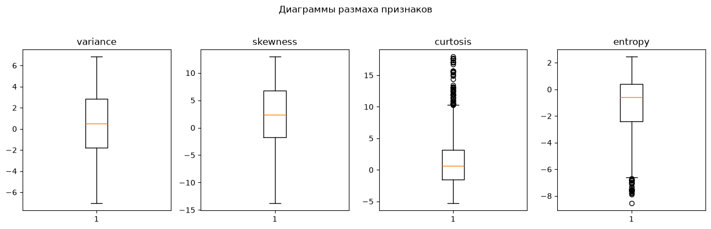

Для каждого из четырёх признаков банкноты отдельно показаны медиана, межквартильный диапазон, «усы» и потенциальные выбросы.

Проверяем, нет ли явно ошибочных значений. Сам факт выхода точки за «усы» не означает, что строку нужно удалить.

### Рисунок 2. Распределения признаков

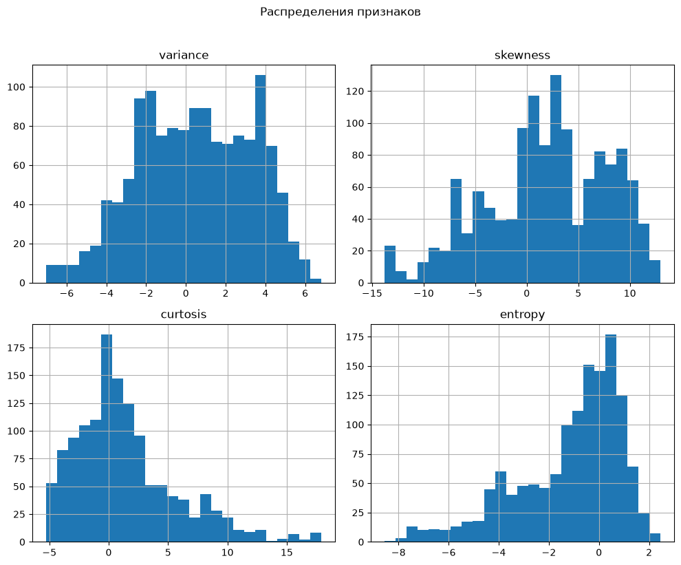

Гистограммы показывают распределение каждого числового признака банкноты.

По ним видно, насколько равномерно распределены значения, есть ли сильный перекос и несколько выраженных групп наблюдений.

### Рисунок 3. Количество объектов каждого класса

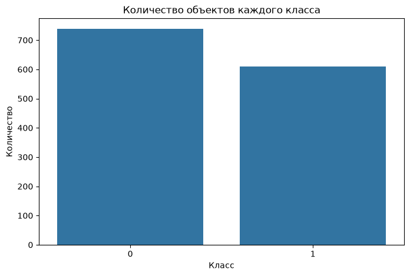

Столбцы показывают количество объектов классов `0` и `1`.

Если один столбец был бы намного выше второго, это означало бы сильный дисбаланс классов. Здесь график используется для проверки, насколько равномерно представлены оба класса.

### Рисунок 4. Матрица корреляции

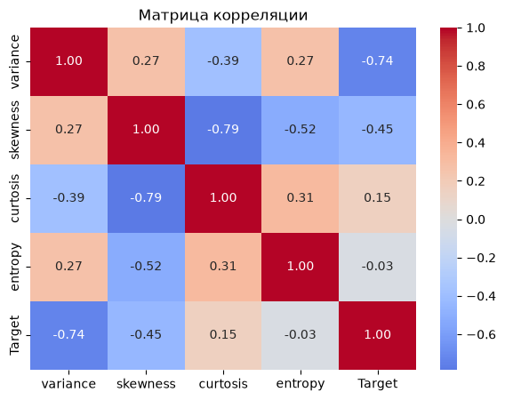

Матрица показывает линейные связи между четырьмя входными признаками и `Target`.

Можно увидеть, какие характеристики сильнее связаны с классом, и проверить наличие сильно взаимосвязанных признаков.

### Рисунок 5. KDE: дисперсия по двум классам банкнот

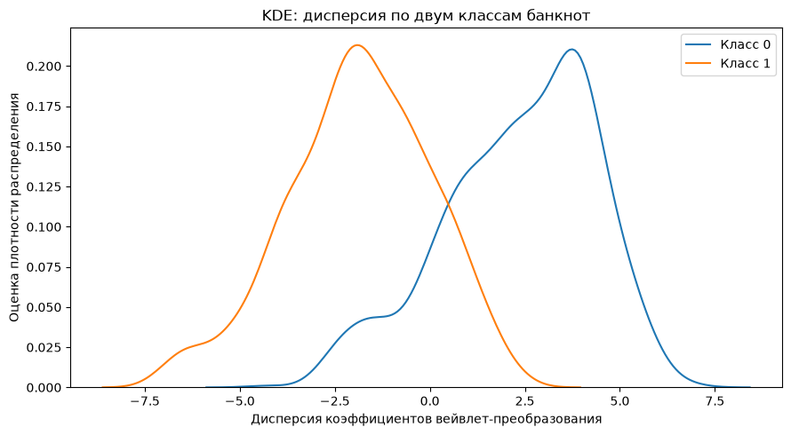

Для сравнения использован график: ядерная оценка плотности (*KDE, kernel density estimation*). `groupby("Target")` делит наблюдения на два класса, а `kdeplot` строит отдельные сглаженные плотности для признака `variance`.

X — значение признака, Y — оценка **плотности**, а не число банкнот. Перекрытие кривых обозначает диапазоны, где один признак не позволяет надёжно различать классы.

Чем лучше разделены кривые, тем потенциально информативнее признак. Это не оценка точности всей модели — она учитывает сразу четыре характеристики.

### Рисунок 6. Диаграмма рассеяния: variance vs skewness, цвет — класс

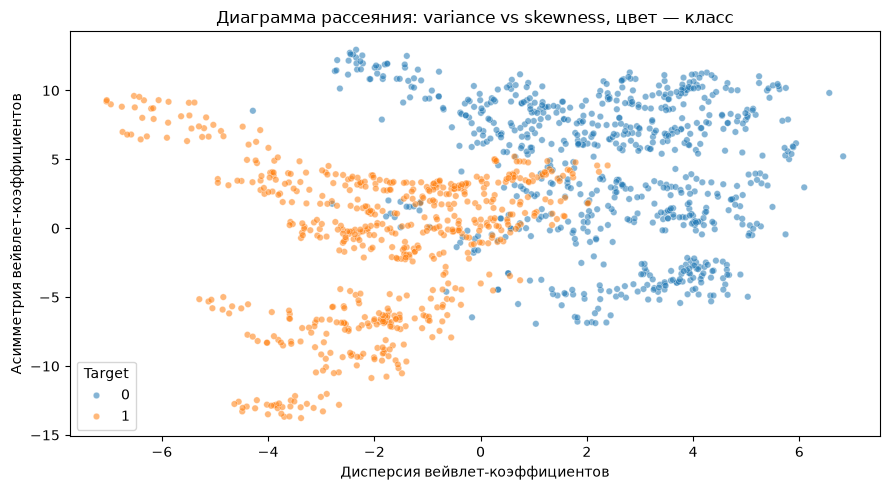

Была построена диаграмма рассеяния по двум признакам (*scatter plot with class coloring*). `hue="Target"` задаёт цвет по истинному классу, `alpha` уменьшает перекрытие точек.

Каждый маркер — одна банкнота; X — дисперсия, Y — асимметрия, цвет — реальная метка. Смешение цветов означает перекрытие классов в этом двумерном срезе.

По двум признакам может быть сложно разделить классы, но логистическая модель использует все четыре признака одновременно.

### Рисунок 7. Violin plot: распределение skewness по классам

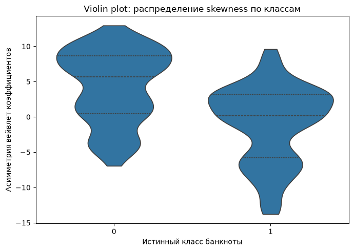

Была построена скрипичная диаграмма (*violin plot*). Сглаженные плотности отдельно для классов `0` и `1`, квартильные линии нанесены внутри.

По X — класс, по Y — значение асимметрии; ширина силуэта характеризует относительную плотность значений на высоте Y.

Различающиеся формы и медианы показывают различия распределений, но не гарантируют, что по одному признаку можно правильно классифицировать все банкноты.

### Рисунок 8. ECDF: энтропия изображения по классам

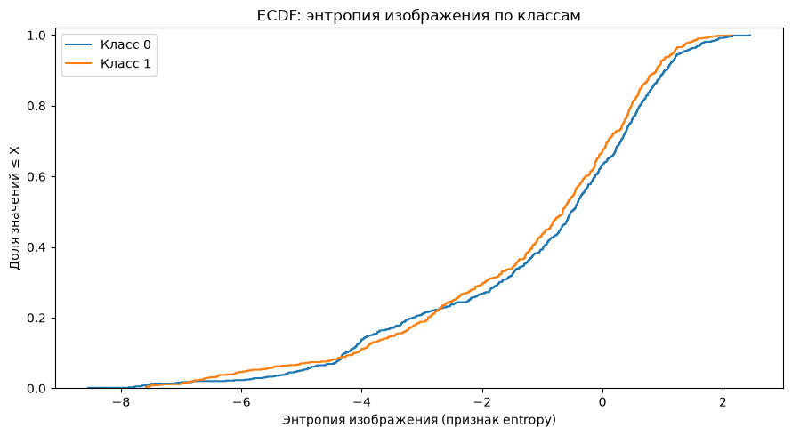

Была построена эмпирическая функция распределения (*ECDF*). Отсортированные значения признака `entropy` преобразуются в накопленную долю объектов каждого класса.

Для каждой линии по X — энтропия, по Y — доля банкнот соответствующего класса, имеющих значение признака не больше X.

Горизонтальный сдвиг линий означает различие распределений; если они совпадают, один признак `entropy` по этому критерию слабо различает группы.

### Рисунок 9. Матрица ошибок

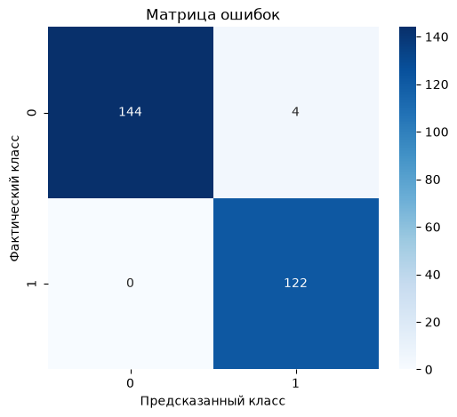

Матрица ошибок сравнивает фактические и предсказанные классы.

Главная диагональ — правильные ответы. Ячейки вне диагонали — ошибки:
- фактический `0`, предсказан `1`;
- фактический `1`, предсказан `0`.

Чем больше значений на диагонали и меньше вне неё, тем лучше работает классификатор.

Поскольку это бинарная задача, матрица имеет размер 2×2. Вне диагонали отображаются ложноположительные и ложноотрицательные решения.

### Рисунок 10. ROC-кривая

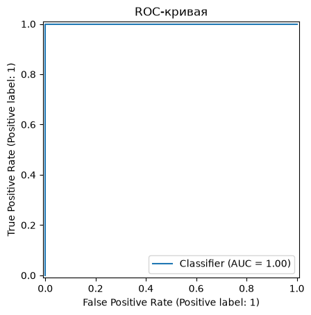

ROC-кривая отображает работу модели при разных порогах перевода вероятности в класс.

Чем ближе кривая проходит к левому верхнему углу, тем лучше модель разделяет классы. Диагональ соответствовала бы почти случайному угадыванию. Численно это качество дополнительно отражает метрика ROC-AUC.

ROC-кривая получена по вероятностям, а не по окончательным меткам. Поэтому она показывает качество разделения при изменении порога классификации.

### Рисунок 11. Кривая Precision–Recall для класса 1

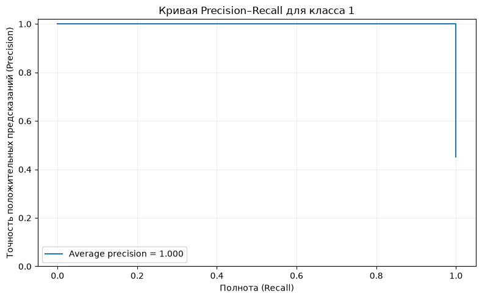

Была построена кривая точности-полноты (*Precision–Recall curve*). `precision_recall_curve` перебирает пороги вероятности, `average_precision_score` вычисляет сводный показатель AP.

X — Recall, Y — Precision для **положительного класса 1**. Увеличение полноты часто сопровождается снижением точности.

Чем выше кривая при сопоставимой полноте, тем лучше способность модели находить положительный класс без большого числа ложных срабатываний. AP — не то же самое, что ROC-AUC.

### Рисунок 12. Распределения предсказанных вероятностей по истинным классам

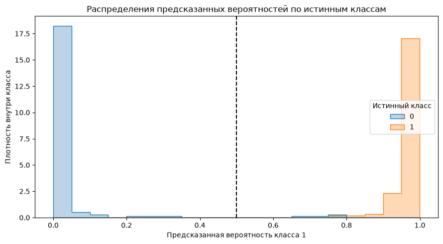

Были построены наложенные гистограммы вероятностей (*class-conditional probability distributions*). `predict_proba` уже вычислен выше; `stat="density", common_norm=False` нормирует распределение отдельно для каждого класса, а пунктир показывает порог 0.5.

По X — вероятность класса 1, по Y — плотность; хорошо разделённые группы обычно сосредоточены ближе к противоположным краям оси.

Объекты классов, попадающие по «неправильную» сторону 0.5, чаще оказываются классификационными ошибками. Это диагностическое описание именно тестовых предсказаний.

### Рисунок 13. Нормированная матрица ошибок (по фактическому классу)

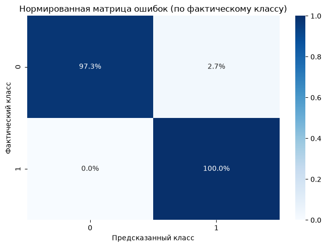

Для сравнения использован график: нормированная тепловая карта ошибок (*row-normalized confusion matrix*). `normalize="true"` делит строки матрицы ошибок на количество объектов соответствующего реального класса.

Числа — доли/проценты внутри каждого **фактического** класса; каждая строка суммируется примерно до 100%.

Диагональные ячейки показывают долю правильно найденных объектов каждого класса (class recall), а боковые — доли ошибок. В отличие от обычной матрицы, проценты удобнее сравнивать, если размеры классов неодинаковы.

### Рисунок 14. Диаграмма калибровки вероятностей (reliability diagram)

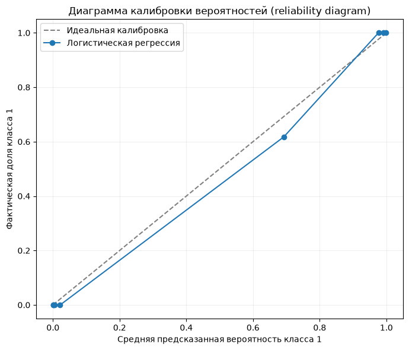

Была построена диаграмма надёжности вероятностей (*calibration / reliability diagram*). `calibration_curve` делит прогнозы на 8 групп по квантилям и сравнивает среднюю вероятность с наблюдаемой частотой класса 1.

X — средняя вероятность, заявленная моделью; Y — доля реально положительных объектов. Идеальные калиброванные вероятности лежали бы на диагонали.

Отклонения от диагонали указывают на завышение или занижение вероятностей. Это отдельное качество, **не тождественное Accuracy или ROC-AUC**. Точек немного: небольшая выборка делает оценку калибровки шумной.

### Рисунок 15. Знаки и величины коэффициентов логистической модели

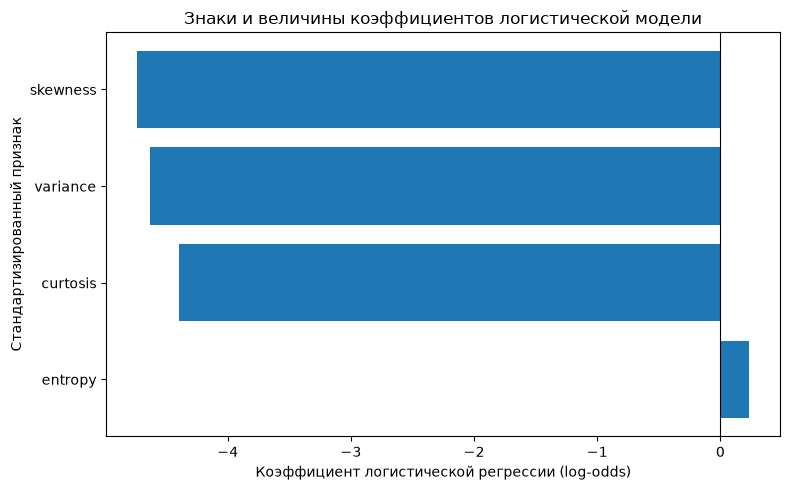

Была построена диаграмма коэффициентов модели (*coefficient bar plot*). `named_steps["logreg"].coef_` получает коэффициенты после стандартизации четырёх признаков; `argsort(abs(...))` сортирует по модулю.

Каждый столбец показывает, как изменение стандартизированного признака на одну единицу влияет на **логарифм шансов** класса 1 при прочих равных.

Положительный коэффициент увеличивает логарифм шансов класса 1, отрицательный — уменьшает. Модуль коэффициента сам по себе **не является причинным эффектом**; при взаимосвязанных признаках интерпретация осторожная.

### Рисунок 16. Сравнение Precision, Recall и F1 по классам

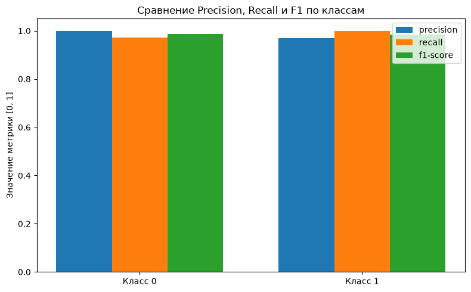

Для сравнения использован график: сгруппированная столбчатая диаграмма (*grouped bar chart*). `classification_report(..., output_dict=True)` получает отдельные Precision, Recall, F1 для классов 0 и 1; три столбца рядом относятся к одному классу.

X — класс, Y — значение метрики в диапазоне 0–1. Различия столбцов показывают, какую именно характеристику качества модель обеспечивает лучше для каждого класса.

Такая детализация не позволяет высокой общей Accuracy скрыть слабый Recall одного из классов.

## Выводы

По матрице ошибок из 270 тестовых объектов правильно классифицировано 266, ошибочно — 4. Accuracy = 0.985. Наименьший Recall получен для класса 0: 0.973.

Наиболее частая ошибка: фактический класс 0, предсказанный 1 (4 объектов).

Площадь под ROC-кривой составила 1.000. Этот показатель характеризует разделение классов при изменении порога, а не калибровку вероятностей.

[Полный ноутбук](02_%D0%9B%D0%BE%D0%B3%D0%B8%D1%81%D1%82%D0%B8%D1%87%D0%B5%D1%81%D0%BA%D0%B0%D1%8F_%D1%80%D0%B5%D0%B3%D1%80%D0%B5%D1%81%D1%81%D0%B8%D1%8F_Banknote.ipynb) · [К содержанию модели](#results) · [К практике](../README.md) · [На главную](../../README.md)
