# 03. Дерево решений

[Главная страница](../../README.md) · [Практическая работа №1](../README.md) · [Ноутбук с кодом и результатами](03_%D0%94%D0%B5%D1%80%D0%B5%D0%B2%D0%BE_%D1%80%D0%B5%D1%88%D0%B5%D0%BD%D0%B8%D0%B9_Raisin.ipynb)

## Описание работы

**Набор данных:** Raisin. Определение сорта изюма по геометрическим признакам.

Были выполнены проверка и подготовка данных, разведочный анализ, обучение модели и оценка на тестовой выборке.

**Источники данных:** [1](https://raw.githubusercontent.com/cynthiakoskei/Raisin-DataSet/main/Raisin_Dataset.csv)

## Содержание

[Результаты и метрики](#results) · [Графики](#figures) · [Выводы](#conclusions)

## Результаты и метрики

Количество объектов в тестовой выборке: **180**.

| Метрика | Значение |
|---|---:|
| Accuracy | 0.872 |
| Precision | 0.832 |
| Recall | 0.933 |
| F1-score | 0.880 |

## Графики

- [1. Диаграммы размаха признаков](#figure-01)
- [2. Распределения признаков](#figure-02)
- [3. Количество объектов каждого сорта](#figure-03)
- [4. Матрица корреляции признаков](#figure-04)
- [5. Scatter plot: площадь и периметр изюма по сортам](#figure-05)
- [6. Violin plot: эксцентриситет по сортам](#figure-06)
- [7. KDE: периметр зерна по сортам](#figure-07)
- [8. Групповой boxplot: параметр Extent по сортам](#figure-08)
- [9. Матрица ошибок](#figure-09)
- [10. Дерево решений](#figure-10)
- [11. Нормированная матрица ошибок дерева (по фактическому классу)](#figure-11)
- [12. Precision, Recall и F1 дерева решений по сортам](#figure-12)
- [13. ROC-кривая дерева решений (класс 1)](#figure-13)
- [14. Кривая сложности модели: глубина и точность дерева](#figure-14)
- [15. Распределение заполненности конечных листьев дерева](#figure-15)
- [16. Важность признаков дерева решений](#figure-16)

### Рисунок 1. Диаграммы размаха признаков

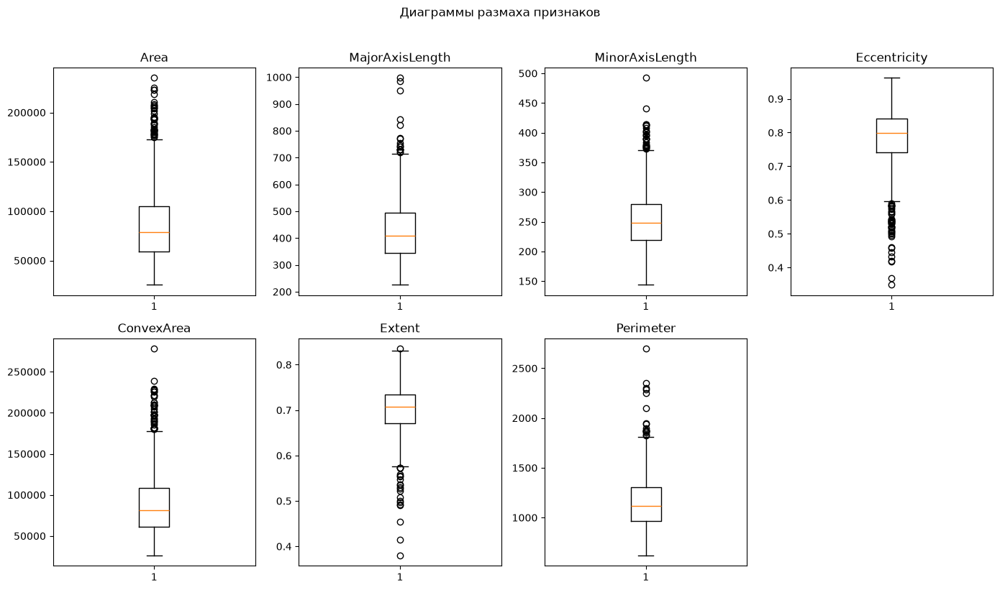

Каждый boxplot описывает распределение одного геометрического признака изюма.

Он помогает увидеть крайние значения и проверить, нет ли очевидных ошибок. Выбросы не удаляются автоматически, потому что зерна изюма действительно могут иметь необычные размеры или форму.

### Рисунок 2. Распределения признаков

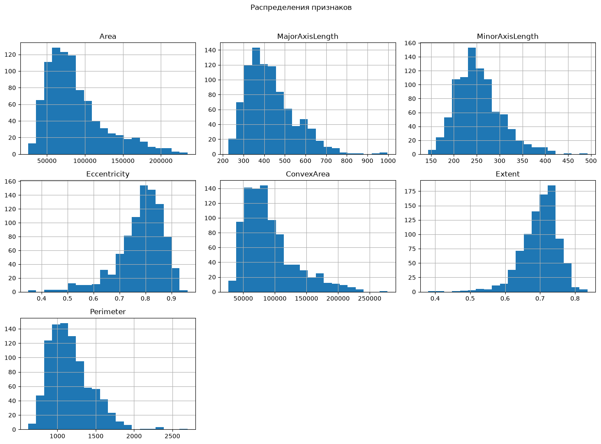

Гистограммы показывают, как распределены площадь, длины осей, эксцентриситет, периметр и другие параметры зерен.

Так можно увидеть диапазоны признаков, форму распределений и возможные группы объектов ещё до обучения дерева.

### Рисунок 3. Количество объектов каждого сорта

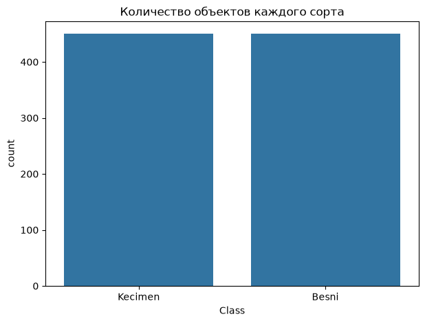

Столбцы показывают количество объектов сортов `Kecimen` и `Besni`.

Проверяем баланс классов. Если один сорт был бы представлен намного чаще второго, одной Accuracy было бы недостаточно для оценки модели.

### Рисунок 4. Матрица корреляции признаков

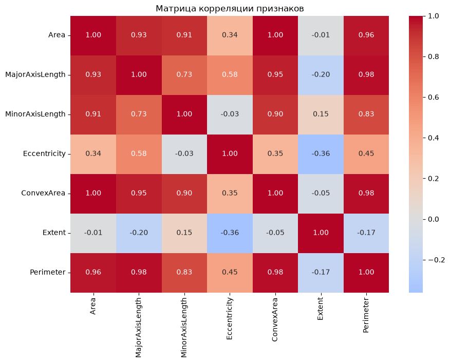

Матрица отражает линейную связь между геометрическими признаками.

**Важно.** Само дерево решений не требует, чтобы признаки были линейно связаны с целью, но корреляционная матрица всё равно полезна как часть EDA: она показывает, какие характеристики несут похожую информацию.

### Рисунок 5. Scatter plot: площадь и периметр изюма по сортам

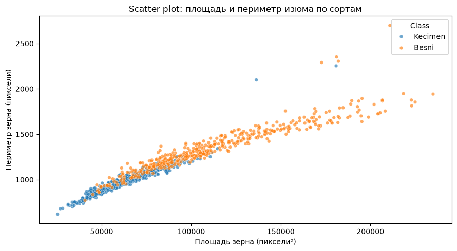

Была построена диаграмма рассеяния с цветовой кодировкой классов. `hue="Class"` раскрашивает каждый объект по реальному сорту.

X — площадь зерна в пикселях², Y — периметр в пикселях; одна точка — один образец. Два цвета показывают сорт `Kecimen` или `Besni`.

Если цветовые облака заметно перекрываются, по одной паре признаков сорта нельзя разделить полностью. Дерево анализирует несколько признаков одновременно.

### Рисунок 6. Violin plot: эксцентриситет по сортам

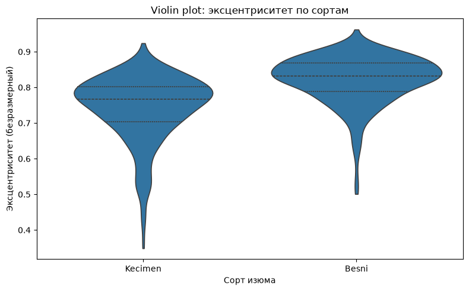

Была построена скрипичная диаграмма. `violinplot` визуализирует плотность эксцентриситета отдельно для двух сортов и показывает их квартильные линии.

X — сорт, Y — эксцентриситет, отражающий вытянутость аппроксимирующего эллипса. У широкого участка силуэта больше относительная частота значений.

Различные формы и медианы указывают на различия между сортами по вытянутости зерна, но не обязательно дают полное разделение.

### Рисунок 7. KDE: периметр зерна по сортам

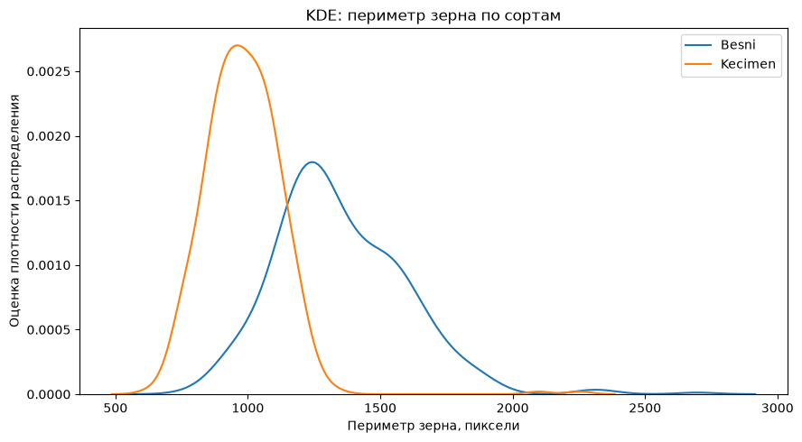

Для сравнения использован график: ядерная оценка плотности (*KDE*). `groupby("Class")` разделяет выборку, `kdeplot` отображает сглаженные плотности периметра.

X — периметр зерна, Y — относительная плотность. Кривые нормированы отдельно и не показывают абсолютное количество объектов.

Участки, где кривые разделяются, могут быть информативны для классификации. Перекрывающиеся области означают, что один признак неоднозначен.

### Рисунок 8. Групповой boxplot: параметр Extent по сортам

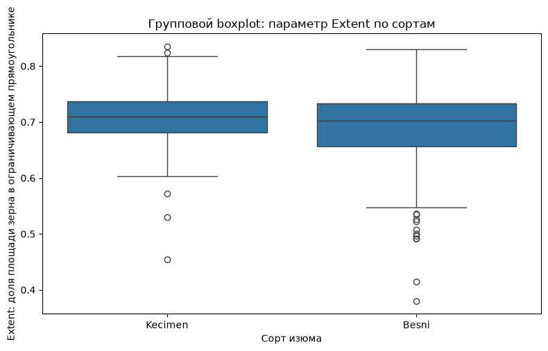

Были построены групповые диаграммы размаха (*grouped boxplots*). `sns.boxplot` строит коробку и «усы» для параметра `Extent` каждого сорта.

X — сорт, Y — безразмерная доля занятой площади; линия внутри коробки — медиана, крайние точки — потенциальные выбросы.

Можно сравнить центральные значения и разброс. Если коробки существенно перекрываются, по одному `Extent` классы точно отделить нельзя.

### Рисунок 9. Матрица ошибок

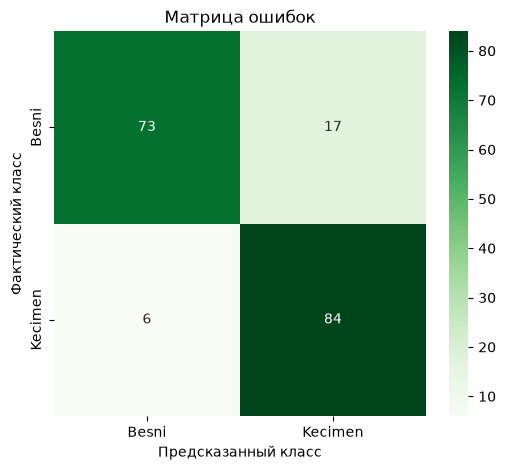

Матрица ошибок показывает, сколько объектов каждого сорта классифицировано правильно и сколько перепутано с другим сортом.

Значения на главной диагонали — правильные ответы. Вне диагонали — ошибки классификации.

### Рисунок 10. Дерево решений

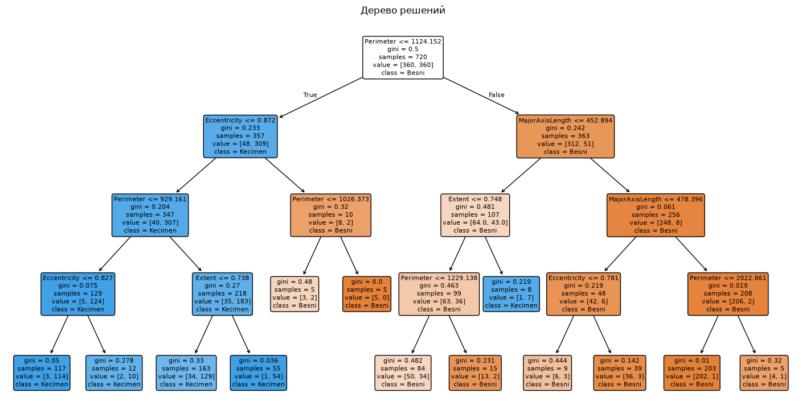

Начинаем с верхнего узла. В каждом узле записано условие вида `признак <= порог`. Если условие выполняется, идём по левой ветви, если нет — по правой. В конечном листе находится итоговый класс.

В узлах также можно увидеть количество объектов и степень смешения классов. Чем ближе лист к одному чистому классу, тем увереннее соответствующее решение.

**Зачем этот график нужен.** Это главное преимущество дерева решений: можно проследить, почему модель отнесла объект к конкретному сорту.

От корневого узла можно перейти к листу по последовательности условий. Ограничение глубины делает схему компактнее и снижает риск запоминания отдельных записей.

### Рисунок 11. Нормированная матрица ошибок дерева (по фактическому классу)

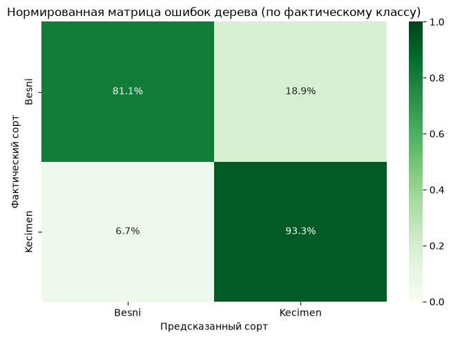

Была построена нормированная матрица ошибок (*normalized confusion matrix*). `normalize="true"` переводит число объектов в проценты внутри каждого фактического класса.

Строка соответствует истинному сорту, столбец — прогнозу. Диагональ показывает полноту распознавания (Recall) соответствующего сорта.

Проценты позволяют объективно сопоставлять ошибки сортов, даже если число тестовых объектов по сортам немного различается.

### Рисунок 12. Precision, Recall и F1 дерева решений по сортам

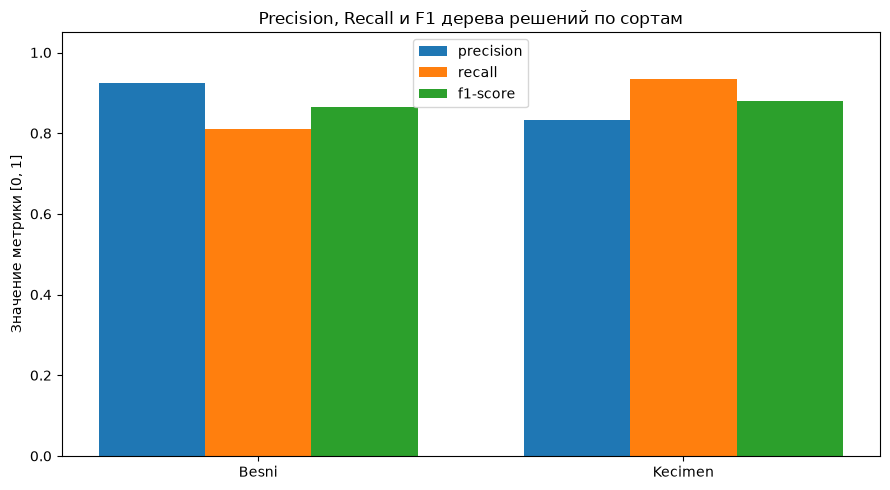

Для сравнения использован график: сгруппированная столбчатая диаграмма качества по классам. `classification_report(..., output_dict=True)` предоставляет метрики для обоих сортов, а `plt.bar` сравнивает их на одной шкале.

X — сорт изюма, Y — значение Precision, Recall или F1. Три соседних столбца описывают один сорт.

Отличие Recall между сортами указывает на неравномерную способность дерева обнаруживать их; это не видно из одной общей Accuracy.

### Рисунок 13. ROC-кривая дерева решений (класс 1)

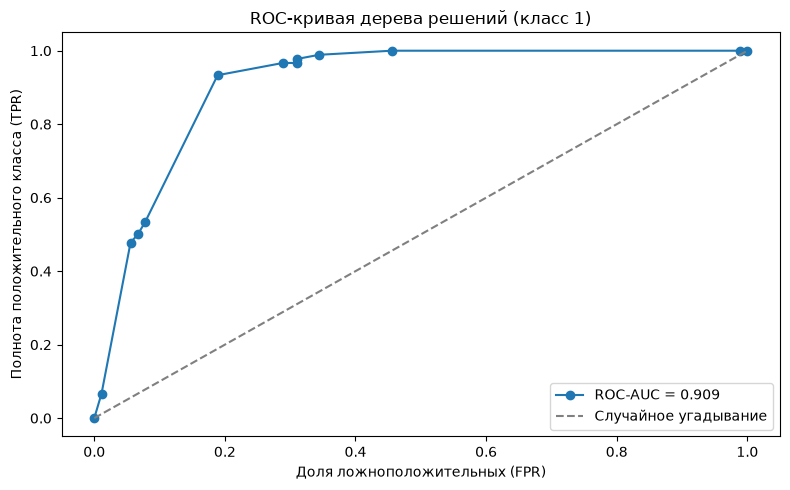

Для сравнения использован график: ROC-кривая классификатора дерева. `predict_proba` извлекает вероятность класса `1`, затем `roc_curve` и `roc_auc_score` строят кривую и вычисляют площадь.

X — FPR, Y — TPR при разных порогах, пунктир — случайное угадывание.

Ближе к верхнему левому углу — лучше. У дерева вероятности обычно принимают ограниченное число значений по листьям, поэтому ROC может выглядеть ступенчатой; это ожидаемо.

### Рисунок 14. Кривая сложности модели: глубина и точность дерева

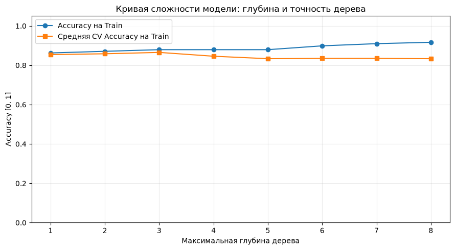

Для сравнения использован график: диагностическая кривая сложности модели (*model complexity curve*). Для глубин 1–8 считается Accuracy на всех обучающих данных и средняя четырёхкратная кросс-валидация **исключительно внутри Train**.

X — максимальная глубина, Y — Accuracy; две линии показывают качество на Train и среднее качество на CV-фолдах.

Увеличение Train Accuracy при застое/падении CV Accuracy может сигнализировать о переобучении. **Тестовая выборка здесь не используется для выбора глубины**; она остаётся независимой от диагностической проверки.

### Рисунок 15. Распределение заполненности конечных листьев дерева

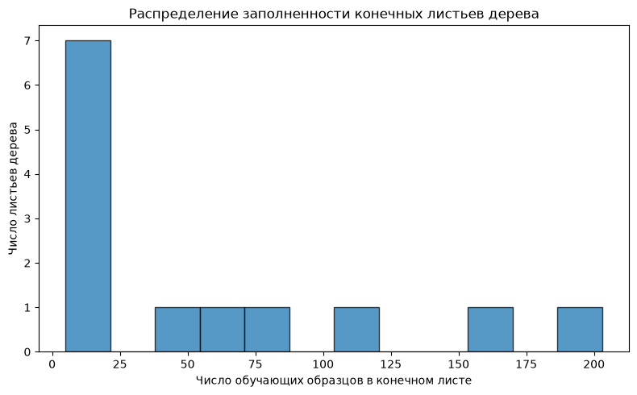

Для сравнения использован график: гистограмма размеров листьев дерева (*leaf occupancy histogram*). `model.apply(X_train)` возвращает номер листа для каждого обучающего объекта; `value_counts()` показывает, сколько объектов в каждом листе.

X — число наблюдений на лист, Y — сколько листьев имеет такой размер.

Множество маленьких листьев указывает на более дробные правила, которые могут быть чувствительны к шуму. У текущей модели размеры не должны быть меньше `min_samples_leaf=5` на обучающей выборке.

### Рисунок 16. Важность признаков дерева решений

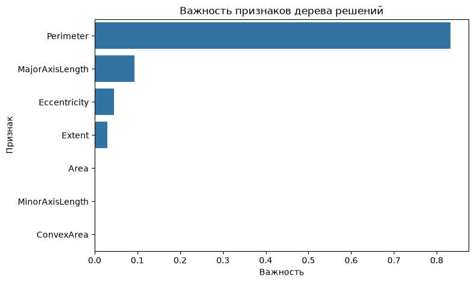

Чем длиннее столбец, тем больше соответствующий признак использовался деревом для полезных разделений данных.

Признак с важностью `0` фактически не участвовал в итоговых решениях дерева. Сумма всех важностей равна примерно `1`.

## Выводы

По матрице ошибок из 180 тестовых объектов правильно классифицировано 157, ошибочно — 23. Accuracy = 0.872. Наименьший Recall получен для класса Besni: 0.811.

Наиболее частая ошибка: фактический класс Besni, предсказанный Kecimen (17 объектов).

Accuracy на Train — 0.879, на Test — 0.872. Разница составляет 0.69 процентного пункта. Наибольшая важность разбиений получена для Perimeter (0.833). Это оценка вклада в модель, а не причинной связи.

На графике сложности наибольшая средняя точность CV для проверенных глубин получена при глубине 3: 0.865. Итоговое дерево сохраняет заданное ограничение глубины 4.

[Полный ноутбук](03_%D0%94%D0%B5%D1%80%D0%B5%D0%B2%D0%BE_%D1%80%D0%B5%D1%88%D0%B5%D0%BD%D0%B8%D0%B9_Raisin.ipynb) · [К содержанию модели](#results) · [К практике](../README.md) · [На главную](../../README.md)
