# 04. Случайный лес

[Главная страница](../../README.md) · [Практическая работа №1](../README.md) · [Ноутбук с кодом и результатами](04_%D0%A1%D0%BB%D1%83%D1%87%D0%B0%D0%B9%D0%BD%D1%8B%D0%B9_%D0%BB%D0%B5%D1%81_Dry_Bean.ipynb)

## Описание работы

**Набор данных:** Dry Bean. Определение одного из семи сортов фасоли.

Были выполнены проверка и подготовка данных, разведочный анализ, обучение модели и оценка на тестовой выборке.

**Источники данных:** [1](https://raw.githubusercontent.com/Apress/reinforcement-learning-finance/main/Dry_Bean_Dataset.csv)

## Содержание

[Результаты и метрики](#results) · [Графики](#figures) · [Выводы](#conclusions)

## Результаты и метрики

Количество объектов в тестовой выборке: **2709**.

| Метрика | Значение |
|---|---:|
| Accuracy | 0.919 |
| Macro Precision | 0.931 |
| Macro Recall | 0.929 |
| Macro F1-score | 0.930 |

## Графики

- [1. Диаграммы размаха признаков Dry Bean](#figure-01)
- [2. Распределения числовых признаков](#figure-02)
- [3. Количество объектов каждого сорта](#figure-03)
- [4. Матрица корреляции признаков](#figure-04)
- [5. Scatter plot: площадь и периметр фасоли по сортам](#figure-05)
- [6. Violin plot: распределение компактности по сортам](#figure-06)
- [7. Групповой boxplot: площадь зерен по сортам](#figure-07)
- [8. ECDF округлости для трёх наиболее представленных сортов](#figure-08)
- [9. Матрица ошибок](#figure-09)
- [10. 10 наиболее важных признаков](#figure-10)
- [11. Нормированная матрица ошибок леса (по строкам)](#figure-11)
- [12. Сравнение Precision, Recall и F1 для семи сортов](#figure-12)
- [13. Распределение уверенности: правильные и ошибочные ответы](#figure-13)
- [14. Сравнение реального и предсказанного распределений классов](#figure-14)
- [15. Доля ошибок по каждому фактическому классу](#figure-15)
- [16. Накопленная важность признаков случайного леса](#figure-16)

### Рисунок 1. Диаграммы размаха признаков Dry Bean

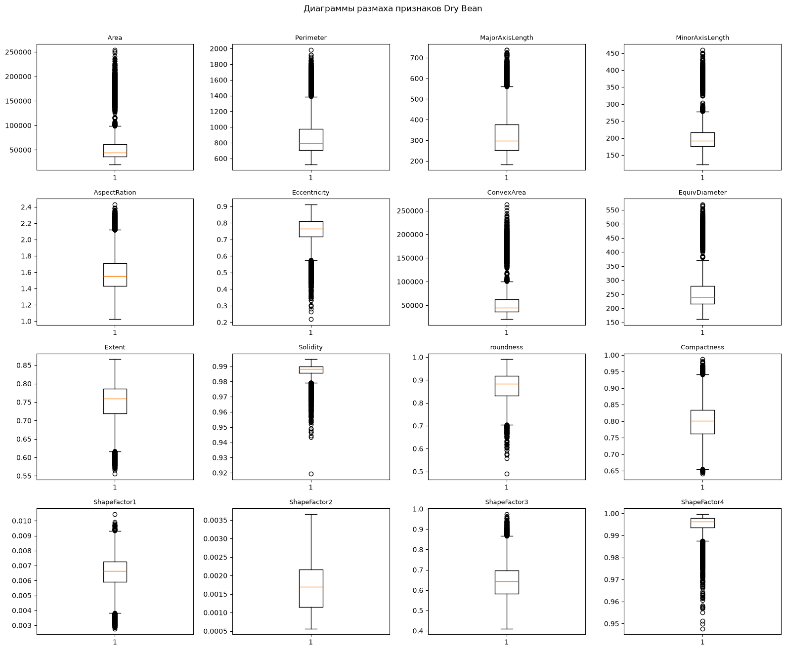

Для каждого числового признака фасоли показан отдельный boxplot с собственной шкалой.

Так удобнее искать потенциальные аномалии в признаках с сильно различающимися диапазонами. Точки за «усами» рассматриваются как кандидаты на выбросы, но не удалялись автоматически.

### Рисунок 2. Распределения числовых признаков

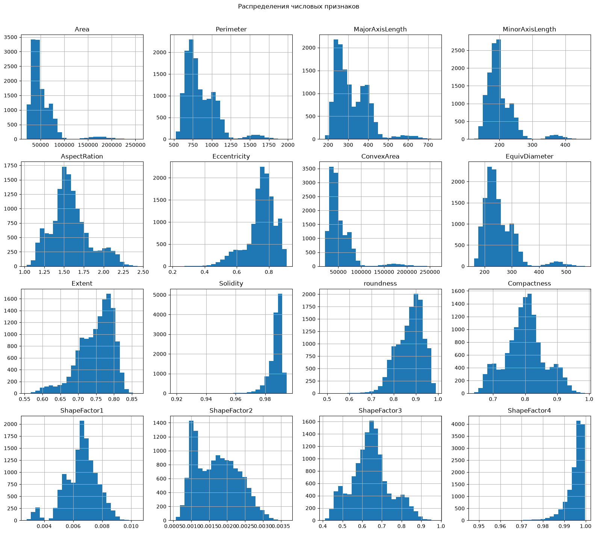

Для каждого геометрического параметра фасоли построена гистограмма распределения.

Можно увидеть диапазоны значений, перекосы и несколько групп наблюдений. Это особенно полезно при большом количестве признаков.

### Рисунок 3. Количество объектов каждого сорта

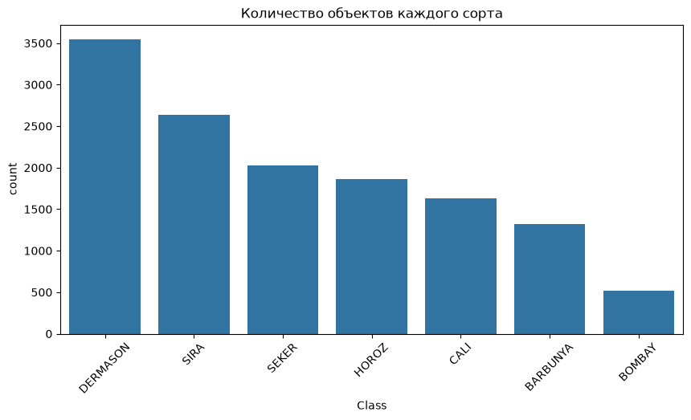

Столбцы показывают количество зерен каждого из семи сортов фасоли.

Классы представлены неодинаково, поэтому кроме общей Accuracy используются Macro Precision, Macro Recall и Macro F1: при таком усреднении каждый сорт получает одинаковый вес.

### Рисунок 4. Матрица корреляции признаков

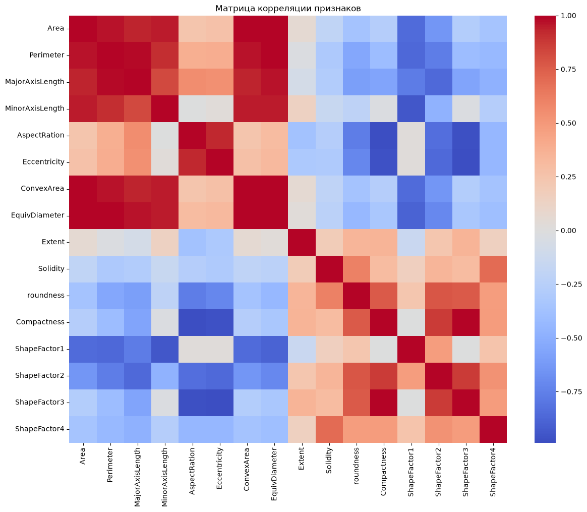

Матрица показывает корреляцию между 16 геометрическими признаками.

Позволяет обнаружить признаки, которые сильно дублируют друг друга по информации. Random Forest может работать и с коррелирующими признаками, но эта визуализация помогает понять структуру датасета.

### Рисунок 5. Scatter plot: площадь и периметр фасоли по сортам

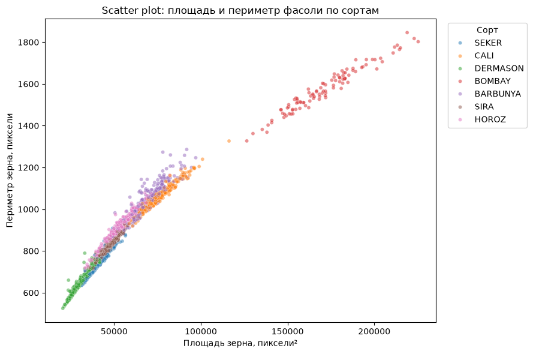

Была построена диаграмма рассеяния с раскраской по семи классам. Для читаемости берётся воспроизводимая случайная подвыборка до 2500 зерен; `hue="Class"` задаёт цвет реального сорта.

X — площадь в пикселях², Y — периметр в пикселях, цвет — сорт. Наложение точек показывает области, в которых классы похожи по двум признакам.

Наблюдаемая двухмерная разделимость **не равна** точности случайного леса: он использует все 16 признаков одновременно.

### Рисунок 6. Violin plot: распределение компактности по сортам

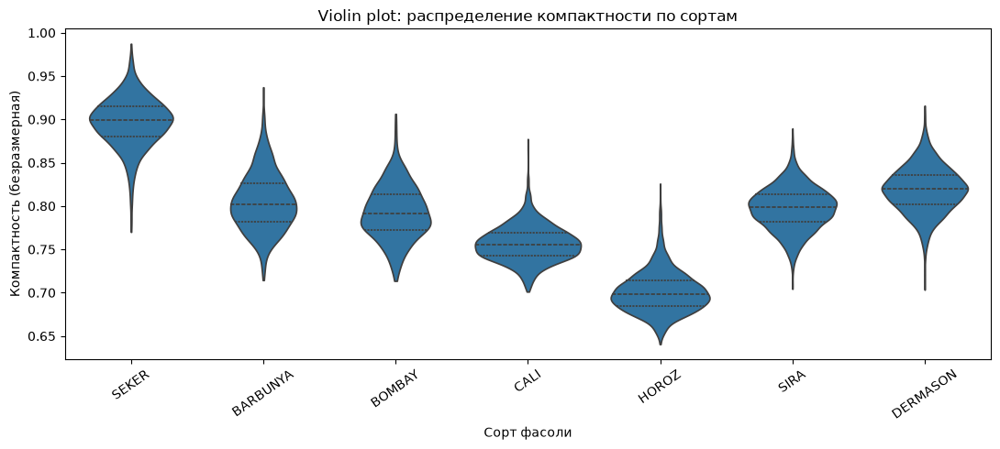

Была построена скрипичная диаграмма (*violin plot*). Каждая скрипка представляет оценку плотности `Compactness` в одном из семи сортов, линии внутри — квартили.

X — сорт, Y — компактность, ширина скрипки — локальная плотность наблюдений.

Если распределения значительно различаются, компактность потенциально информативна для классификации. Перекрытие распределений означает, что по одной компактности определение сорта неоднозначно.

### Рисунок 7. Групповой boxplot: площадь зерен по сортам

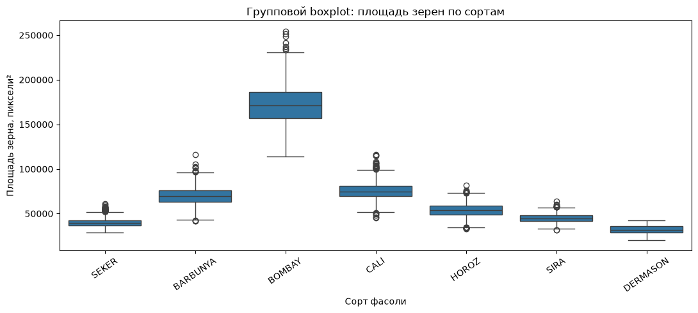

Были построены групповые диаграммы размаха. `sns.boxplot` строит распределение площади для каждого сорта.

X — названия семи сортов, Y — площадь зерна; внутри каждой коробки медиана и межквартильный размах, за «усами» — возможные выбросы.

Можно сопоставить типичные размеры зерен и разброс в классах. Большая коробка означает высокий вариационный размах, а не обязательно плохие данные.

### Рисунок 8. ECDF округлости для трёх наиболее представленных сортов

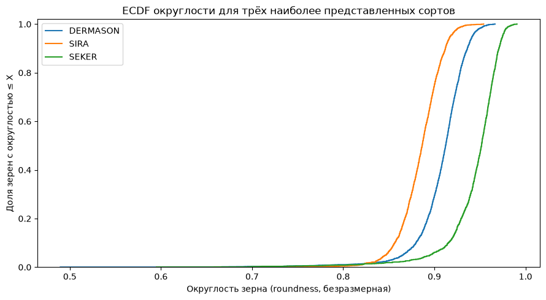

Были построены эмпирические функции распределения (*ECDF*) по трём наиболее многочисленным сортам. `value_counts().head(3)` выбирает 3 класса, `np.sort` и накопленные доли строят отдельные кривые.

По X — безразмерная округлость, по Y — доля объектов с округлостью не выше выбранного значения.

Разнесённые линии указывают на различия распределений округлости. Показаны только три класса для читаемости; **это не сравнительная оценка всех семи сортов**.

### Рисунок 9. Матрица ошибок

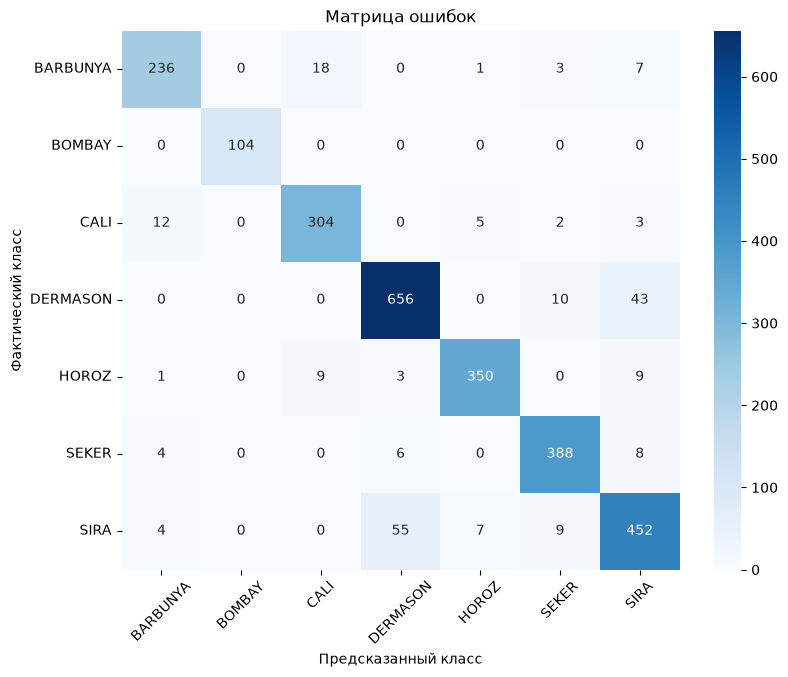

Это матрица ошибок для семи классов. Строки соответствуют фактическим сортам, столбцы — предсказанным.

Главная диагональ содержит правильные ответы. Значения вне диагонали показывают, какие конкретно сорта модель путает между собой.

Для матрицы ошибок особенно важно не только общее число правильных ответов, но и те пары сортов, между которыми возникают систематические ошибки.

### Рисунок 10. 10 наиболее важных признаков

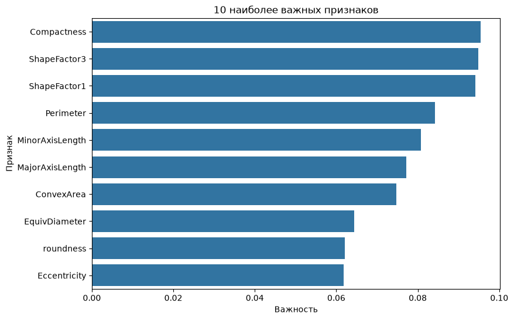

Показаны десять признаков с наибольшей важностью по оценке случайного леса.

Чем длиннее столбец, тем больший вклад признак в среднем вносил в полезные разделения всех деревьев леса. В отличие от одиночного дерева, здесь важность агрегируется по всему ансамблю.

### Рисунок 11. Нормированная матрица ошибок леса (по строкам)

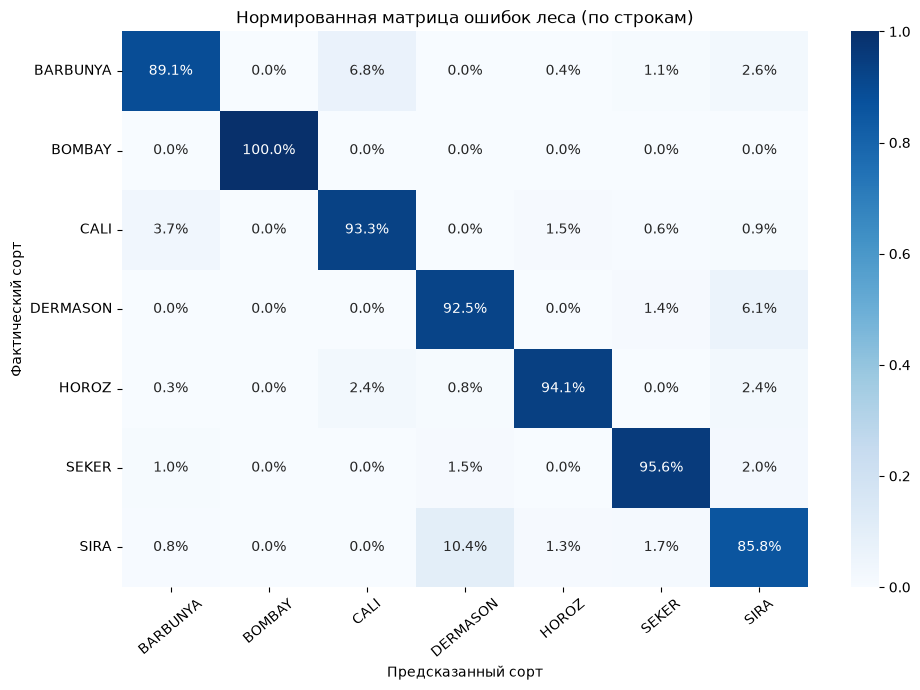

Была построена матрица ошибок с нормировкой по фактическому классу. `normalize="true"` делит значения каждой строки на число тестовых объектов реального сорта.

Каждая строка суммируется до 100%; диагональ соответствует полноте распознавания сорта, другие клетки — видам ошибок.

Проценты удобнее численностей для сравнения качества распознавания классов разного размера.

### Рисунок 12. Сравнение Precision, Recall и F1 для семи сортов

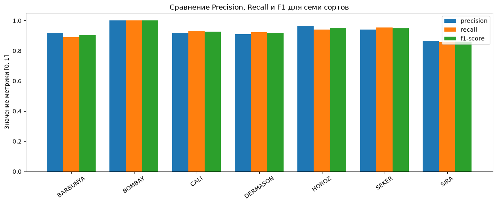

Были построены сгруппированные столбчатые диаграммы качества по классам. Из `classification_report(..., output_dict=True)` извлекаются Precision/Recall/F1 каждого из семи сортов.

X — класс, Y — метрика 0–1; три рядом стоящих столбца описывают один сорт.

Значительные различия Recall/F1 между сортами показывают, какие классы сложнее для леса, даже если общая Accuracy высокая.

### Рисунок 13. Распределение уверенности: правильные и ошибочные ответы

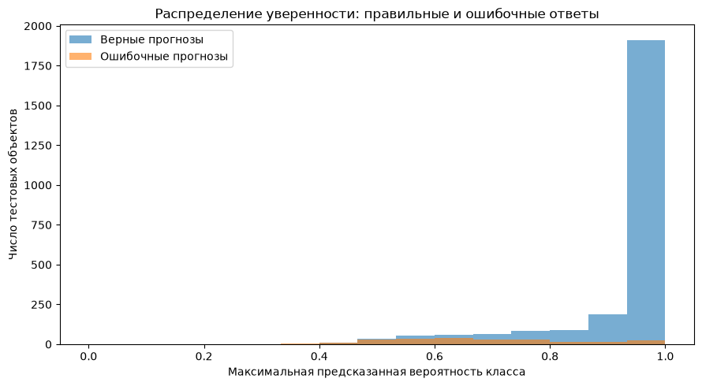

Были построены наложенные гистограммы уверенности (*confidence histograms*). `predict_proba` возвращает вероятности семи классов; максимум по строке — уверенность в выбранном классе, `correct_flag` отделяет верные прогнозы от ошибок.

X — максимальная вероятность в диапазоне 0–1, Y — число тестовых зерен. Наложение показывает, бывают ли ошибки при высокой уверенности.

Высокая уверенность не гарантирует правильность. У дерева ансамбля вероятности **не обязательно калиброваны**, поэтому их нельзя автоматически считать реальными частотами событий.

### Рисунок 14. Сравнение реального и предсказанного распределений классов

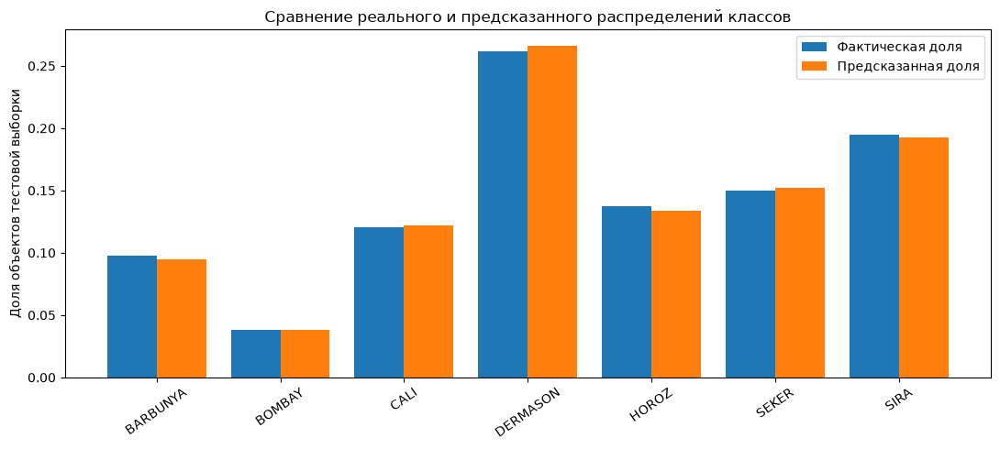

Для сравнения использован график: сгруппированная диаграмма относительных частот. `value_counts(normalize=True)` получает доли объектов по каждому классу отдельно для реальных и предсказанных меток.

X — сорт, Y — доля тестовых зерен данного сорта; два столбца в каждой группе сравнивают реальное и прогнозируемое распределение.

Сильное отличие высот показывает систематическое пере- или недопредсказание какого-либо класса. **Совпадение суммарных долей само по себе не гарантирует правильной классификации отдельных объектов.**

### Рисунок 15. Доля ошибок по каждому фактическому классу

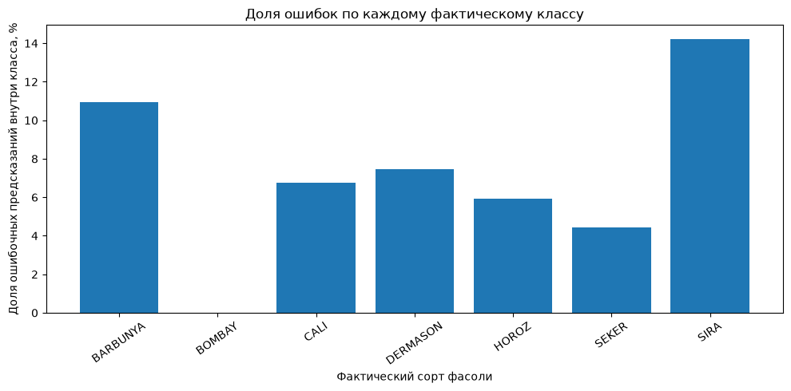

Была построена столбчатая диаграмма частоты ошибок по классам. Диагональ нормированной матрицы `cm_norm` содержит Recall сорта, поэтому `1 - Recall` даёт долю объектов, классифицированных неверно.

X — фактический сорт, Y — процент ошибок внутри этого сорта. Низкий столбец соответствует лучшему распознаванию сорта.

Это удобный способ выделить самые проблемные классы. Частота ошибок не отражает сама по себе цену или серьёзность разных типов ошибок.

### Рисунок 16. Накопленная важность признаков случайного леса

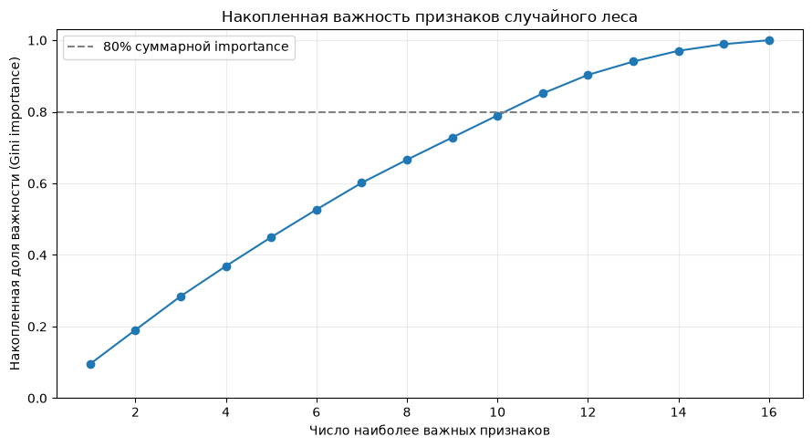

Была построена кривая накопленной важности признаков (*cumulative feature importance curve*). Сортируем `feature_importances_` по убыванию и накапливаем сумму `cumsum`.

X — сколько самых важных признаков учтено, Y — какая доля общей impurity-based importance на них приходится.

Быстрый рост в начале означает, что небольшое число признаков отвечает за большую часть снижений неоднородности в лесу. Это **не доля объяснённой дисперсии и не гарантированное качество модели при удалении остальных признаков**.

## Выводы

По матрице ошибок из 2709 тестовых объектов правильно классифицировано 2490, ошибочно — 219. Accuracy = 0.919. Наименьший Recall получен для класса SIRA: 0.858.

Наиболее частая ошибка: фактический класс SIRA, предсказанный DERMASON (55 объектов).

Accuracy на Train — 1.000, на Test — 0.919. Разница составляет 8.08 процентного пункта. Наибольшая важность разбиений получена для Compactness (0.095). Это оценка вклада в модель, а не причинной связи.

[Полный ноутбук](04_%D0%A1%D0%BB%D1%83%D1%87%D0%B0%D0%B9%D0%BD%D1%8B%D0%B9_%D0%BB%D0%B5%D1%81_Dry_Bean.ipynb) · [К содержанию модели](#results) · [К практике](../README.md) · [На главную](../../README.md)
