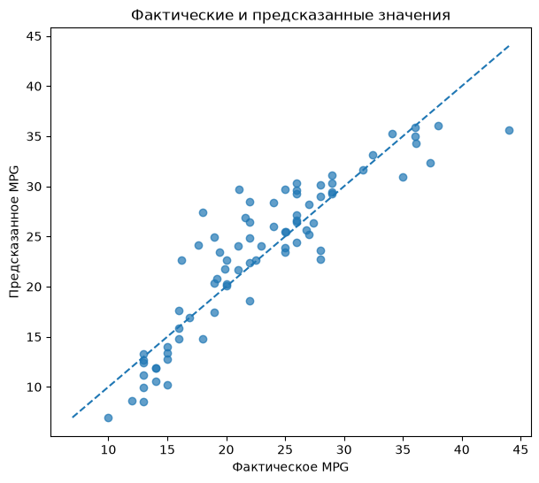
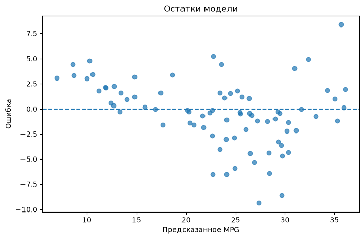
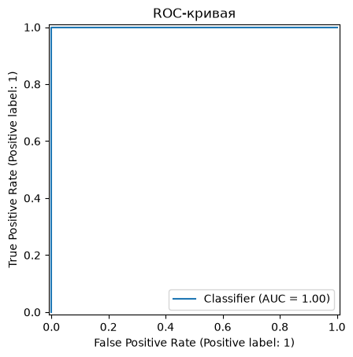
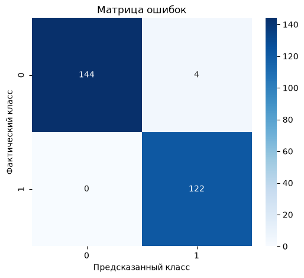
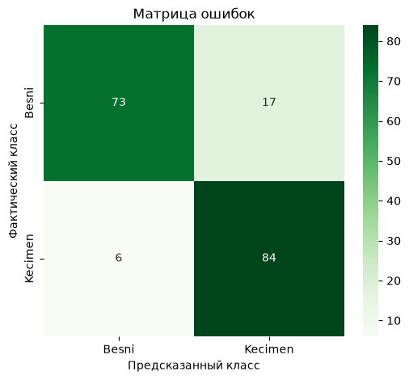
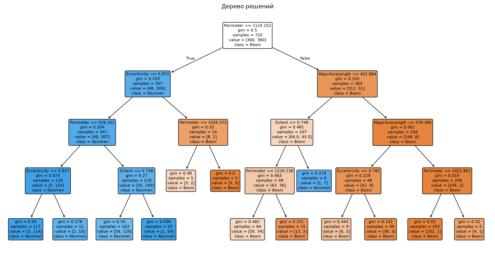
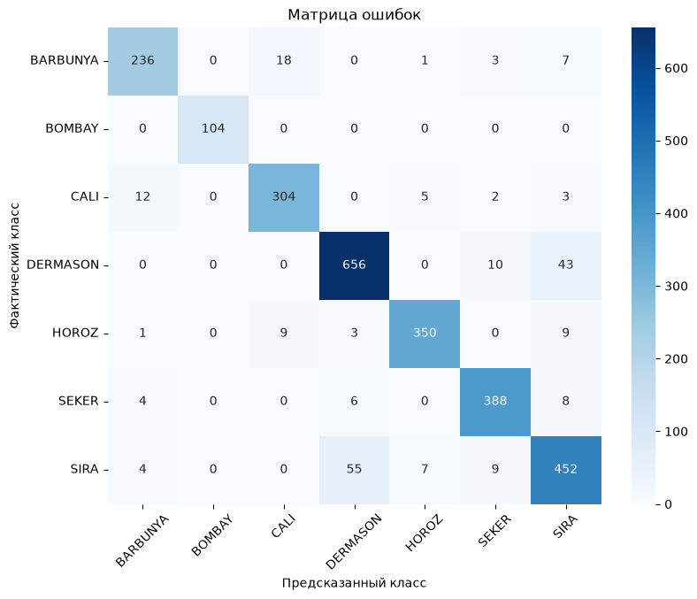
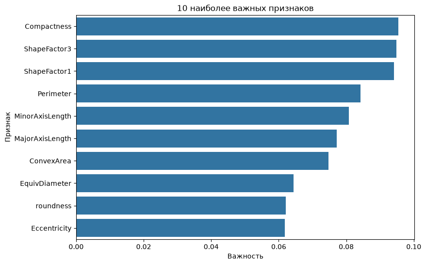

# Практическая работа №1. Классические алгоритмы машинного обучения

[Главная страница](../README.md) · [Результаты](#results) · [Графики](#figures) · [Общий вывод](#conclusions)

## Описание работы

В работе рассмотрены четыре классических алгоритма для задач регрессии и классификации.

## Содержание и результаты

| Модель | Датасет | Метрики на Test | Графики |
|---|---|---|---:|
| [Линейная регрессия](01_Linear_Regression/README.md) · [ноутбук](01_Linear_Regression/01_%D0%9B%D0%B8%D0%BD%D0%B5%D0%B9%D0%BD%D0%B0%D1%8F_%D1%80%D0%B5%D0%B3%D1%80%D0%B5%D1%81%D1%81%D0%B8%D1%8F_Auto_MPG.ipynb) | Auto MPG | MAE = 2.462; RMSE = 3.256; R² = 0.792 | [15](01_Linear_Regression/README.md#figures) |
| [Логистическая регрессия](02_Logistic_Regression/README.md) · [ноутбук](02_Logistic_Regression/02_%D0%9B%D0%BE%D0%B3%D0%B8%D1%81%D1%82%D0%B8%D1%87%D0%B5%D1%81%D0%BA%D0%B0%D1%8F_%D1%80%D0%B5%D0%B3%D1%80%D0%B5%D1%81%D1%81%D0%B8%D1%8F_Banknote.ipynb) | Banknote Authentication | Accuracy = 0.985; Precision = 0.968; Recall = 1.000; F1-score = 0.984; ROC-AUC = 1.000 | [16](02_Logistic_Regression/README.md#figures) |
| [Дерево решений](03_Decision_Tree/README.md) · [ноутбук](03_Decision_Tree/03_%D0%94%D0%B5%D1%80%D0%B5%D0%B2%D0%BE_%D1%80%D0%B5%D1%88%D0%B5%D0%BD%D0%B8%D0%B9_Raisin.ipynb) | Raisin | Accuracy = 0.872; Precision = 0.832; Recall = 0.933; F1-score = 0.880 | [16](03_Decision_Tree/README.md#figures) |
| [Случайный лес](04_Random_Forest/README.md) · [ноутбук](04_Random_Forest/04_%D0%A1%D0%BB%D1%83%D1%87%D0%B0%D0%B9%D0%BD%D1%8B%D0%B9_%D0%BB%D0%B5%D1%81_Dry_Bean.ipynb) | Dry Bean | Accuracy = 0.919; Macro Precision = 0.931; Macro Recall = 0.929; Macro F1-score = 0.930 | [16](04_Random_Forest/README.md#figures) |

## Основные графики и результаты

### 01. Линейная регрессия

Прогноз топливной экономичности автомобиля. Средняя абсолютная ошибка на тестовой выборке составила 2.462 MPG, RMSE — 3.256 MPG. R² = 0.792. Модель по квадратичной ошибке оказалась лучше прогноза среднего тестовой выборки.

**Фактические и предсказанные значения**

[Пояснение к графику](01_Linear_Regression/README.md#figure-10)

**Остатки модели**

[Пояснение к графику](01_Linear_Regression/README.md#figure-11)

[Все графики и выводы](01_Linear_Regression/README.md) · [Метрики](01_Linear_Regression/README.md#results) · [Ноутбук](01_Linear_Regression/01_%D0%9B%D0%B8%D0%BD%D0%B5%D0%B9%D0%BD%D0%B0%D1%8F_%D1%80%D0%B5%D0%B3%D1%80%D0%B5%D1%81%D1%81%D0%B8%D1%8F_Auto_MPG.ipynb)

### 02. Логистическая регрессия

Классификация банкнот по характеристикам изображения. По матрице ошибок из 270 тестовых объектов правильно классифицировано 266, ошибочно — 4. Accuracy = 0.985. Наименьший Recall получен для класса 0: 0.973.

**ROC-кривая**

[Пояснение к графику](02_Logistic_Regression/README.md#figure-10)

**Матрица ошибок**

[Пояснение к графику](02_Logistic_Regression/README.md#figure-09)

[Все графики и выводы](02_Logistic_Regression/README.md) · [Метрики](02_Logistic_Regression/README.md#results) · [Ноутбук](02_Logistic_Regression/02_%D0%9B%D0%BE%D0%B3%D0%B8%D1%81%D1%82%D0%B8%D1%87%D0%B5%D1%81%D0%BA%D0%B0%D1%8F_%D1%80%D0%B5%D0%B3%D1%80%D0%B5%D1%81%D1%81%D0%B8%D1%8F_Banknote.ipynb)

### 03. Дерево решений

Определение сорта изюма по геометрическим признакам. По матрице ошибок из 180 тестовых объектов правильно классифицировано 157, ошибочно — 23. Accuracy = 0.872. Наименьший Recall получен для класса Besni: 0.811.

**Матрица ошибок**

[Пояснение к графику](03_Decision_Tree/README.md#figure-09)

**Дерево решений**

[Пояснение к графику](03_Decision_Tree/README.md#figure-10)

[Все графики и выводы](03_Decision_Tree/README.md) · [Метрики](03_Decision_Tree/README.md#results) · [Ноутбук](03_Decision_Tree/03_%D0%94%D0%B5%D1%80%D0%B5%D0%B2%D0%BE_%D1%80%D0%B5%D1%88%D0%B5%D0%BD%D0%B8%D0%B9_Raisin.ipynb)

### 04. Случайный лес

Определение одного из семи сортов фасоли. По матрице ошибок из 2709 тестовых объектов правильно классифицировано 2490, ошибочно — 219. Accuracy = 0.919. Наименьший Recall получен для класса SIRA: 0.858.

**Матрица ошибок**

[Пояснение к графику](04_Random_Forest/README.md#figure-09)

**10 наиболее важных признаков**

[Пояснение к графику](04_Random_Forest/README.md#figure-10)

[Все графики и выводы](04_Random_Forest/README.md) · [Метрики](04_Random_Forest/README.md#results) · [Ноутбук](04_Random_Forest/04_%D0%A1%D0%BB%D1%83%D1%87%D0%B0%D0%B9%D0%BD%D1%8B%D0%B9_%D0%BB%D0%B5%D1%81_Dry_Bean.ipynb)

## Общий вывод

Результаты разных моделей получены на разных наборах данных. Значения метрик характеризуют качество решения соответствующей задачи и не являются прямым рейтингом алгоритмов. Графики и численные показатели рассмотрены совместно.

[Вернуться к главному README](../README.md)
