# Практическая работа №2. Все три модели

[Главная](../../README.md) · [Практика](../README.md) · [Общий ноутбук](00_practice_2_all_networks.ipynb)

В общем ноутбуке последовательно представлены те же кодовые блоки, пояснения и сохранённые результаты, что и в отдельных файлах. Общие зависимости и функции приведены один раз.

## Результаты

| Модель | Датасет | Train / Validation / Test | Метрики Test | Графики |
|---|---|---:|---|---:|
| [Полносвязная нейронная сеть (FCN)](../01_FCN/README.md) · [Код](../01_FCN/01_fcn_bank_marketing.ipynb) | [UCI Bank Marketing](https://archive.ics.uci.edu/dataset/222/bank+marketing) | 31 636 / 6 779 / 6 780 | Accuracy: 0.761; Macro Precision: 0.614; Macro Recall: 0.721; Macro F1: 0.623; Precision (yes): 0.281; Recall (yes): 0.669; ROC-AUC: 0.788; PR-AUC (AP): 0.417 | [12](../01_FCN/README.md#figures) |
| [Свёрточная нейронная сеть (CNN)](../02_CNN/README.md) · [Код](../02_CNN/02_cnn_fashion_mnist.ipynb) | [Fashion-MNIST, Zalando Research](https://github.com/zalandoresearch/fashion-mnist) | 51 000 / 9 000 / 10 000 | Accuracy: 0.906; Macro Precision: 0.906; Macro Recall: 0.906; Macro F1: 0.906 | [12](../02_CNN/README.md#figures) |
| [Рекуррентная нейронная сеть (RNN)](../03_RNN/README.md) · [Код](../03_RNN/03_rnn_jena_climate.ipynb) | [Jena Climate / Keras](https://keras.io/examples/timeseries/timeseries_weather_forecasting/) | 49 066 / 10 428 / 10 397 | MAE (°C): 0.393; RMSE (°C): 0.562; R2: 0.995; Baseline MAE (°C): 0.647; Baseline RMSE (°C): 0.905 | [12](../03_RNN/README.md#figures) |

## Графики

### Полносвязная нейронная сеть (FCN)

После очистки для обучения использовано 31636 клиентов. Accuracy=0.761, Macro F1=0.623, Recall yes=0.669; ROC-AUC=0.788. При дисбалансе следует учитывать полноту класса yes, а не только общую точность.

**Распределение классов**

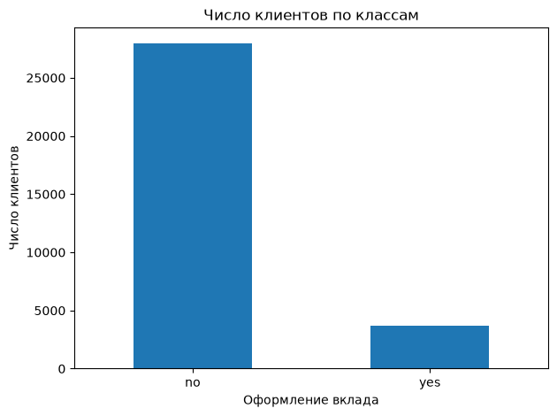

Столбцы показывают количество клиентов с ответами no и yes. Различие высот отражает дисбаланс; поэтому одной Accuracy недостаточно, используется Macro F1 и полнота положительного класса.

**Гистограмма возраста**

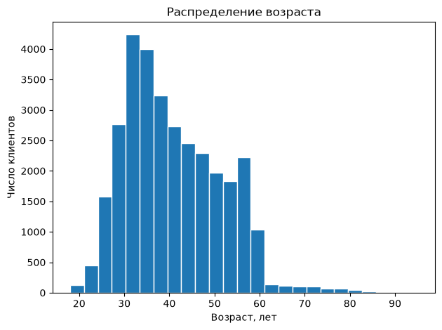

Гистограмма делит возраст на 25 интервалов. Высота столбца соответствует числу клиентов; по форме можно определить наиболее распространённый возраст и крайние группы.

**Диаграмма размаха баланса**

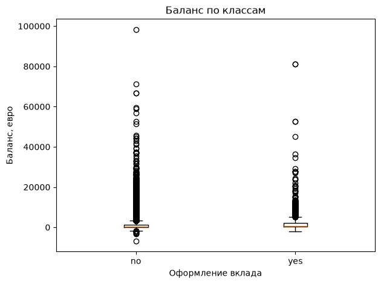

Линия внутри коробки — медиана, границы — первый и третий квартили; усы ограничены правилом 1,5 IQR. Точки вне усов могут быть реальными крупными суммами. Сопоставляются различия распределений двух классов.

**Эмпирическая функция распределения**

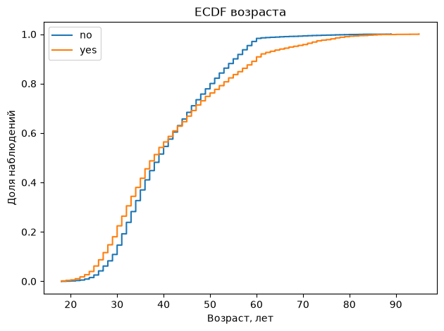

ECDF показывает долю клиентов с возрастом не больше значения по X. Расхождение кривых отражает различие распределений, но не устанавливает причинную связь.

**Диаграмма рассеяния**

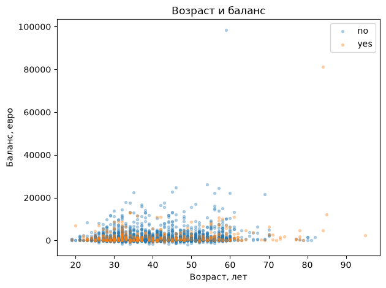

Каждая точка — одна запись из случайной подвыборки Train для читаемости. Перекрытие цветов показывает, почему двух признаков может быть недостаточно для разделения классов. Обучение использует всю Train.

**Корреляционная матрица**

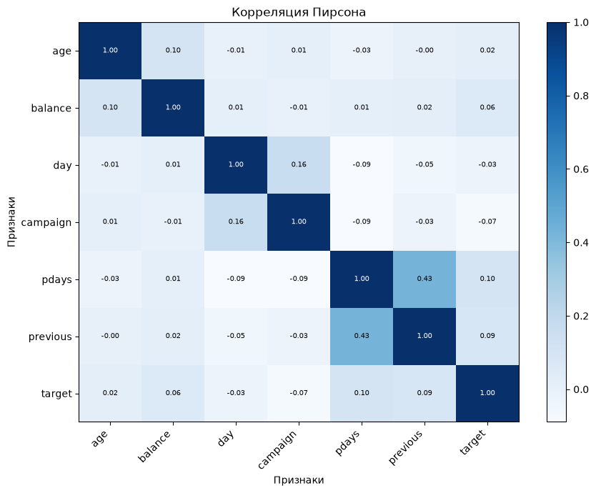

Коэффициенты от −1 до 1 характеризуют линейную связь числовых признаков. Диагональ равна единице для непостоянных признаков; отрицательные значения не означают слабую связь. Корреляция не доказывает причинность.

**Кривые функции потерь**

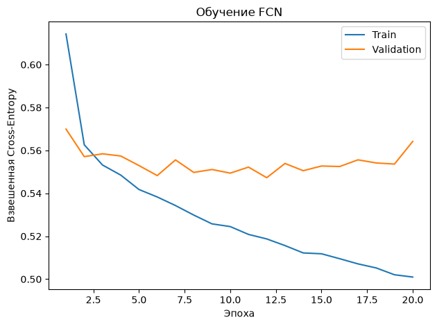

Снижение обеих кривых указывает на уменьшение ошибки. Рост Validation при дальнейшем падении Train может свидетельствовать о переобучении; выбор весов выполнялся по минимуму Validation.

**Матрица ошибок**

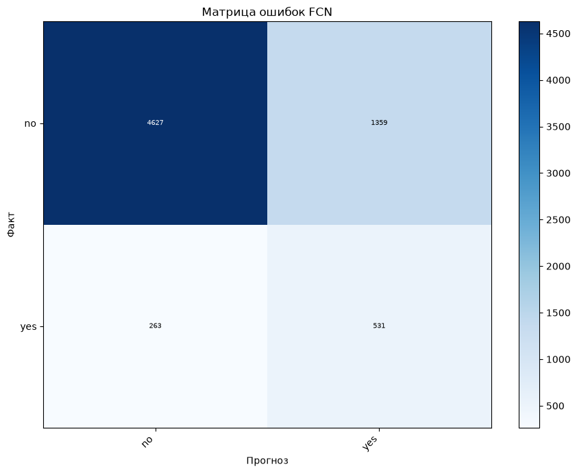

На диагонали — верные ответы. Верхняя правая клетка — ошибочное предсказание вклада, нижняя левая — пропущенный вклад. Числа дают абсолютное количество ошибок.

**ROC-кривая**

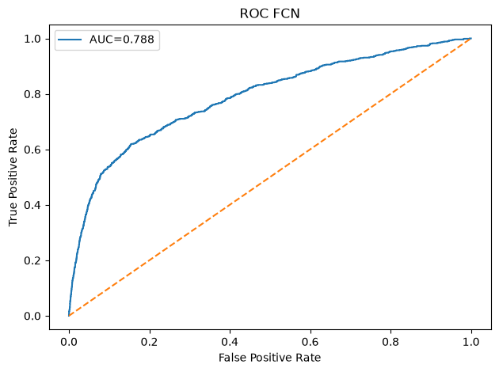

Кривая показывает компромисс между долей ложных срабатываний и долей найденных положительных объектов при разных порогах. Чем ближе линия к левому верхнему углу, тем лучше ранжирование.

**Кривая Precision–Recall**

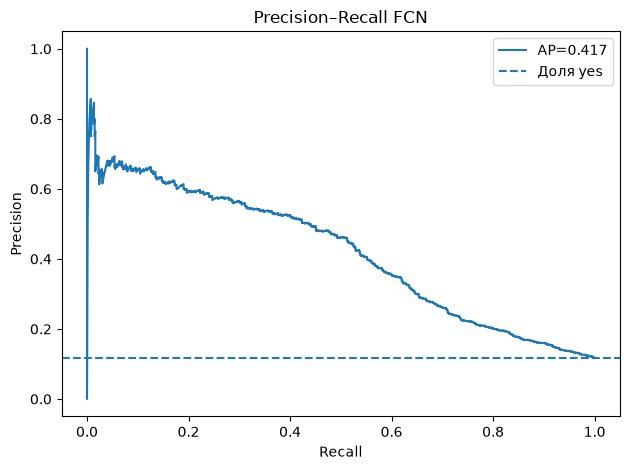

PR-кривая особенно полезна для редкого положительного класса. Пунктир показывает долю положительных объектов, а AP характеризует качество ранжирования по precision и recall.

**Распределение оценок модели**

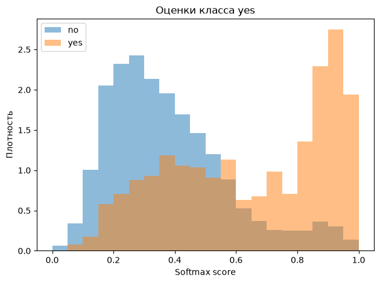

По оси X — оценка принадлежности к yes, по Y — нормированная плотность. Перекрытие отражает неоднозначные случаи; взвешенная функция потерь может влиять на калибровку вероятностей.

**Метрики по классам**

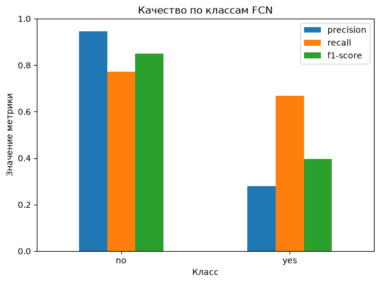

Группы столбцов сравнивают качество для каждого класса. Низкий Recall класса yes означает пропущенные вклады. Macro F1 усредняет F1 классов без учёта их численности.

[Отдельная работа](../01_FCN/README.md)

### Свёрточная нейронная сеть (CNN)

Для обучения CNN использовано 51000 отдельных изображений. На Test получены Accuracy=0.906 и Macro F1=0.906. Матрица ошибок и метрики по классам позволяют оценить различия в распознавании категорий.

**Примеры изображений**

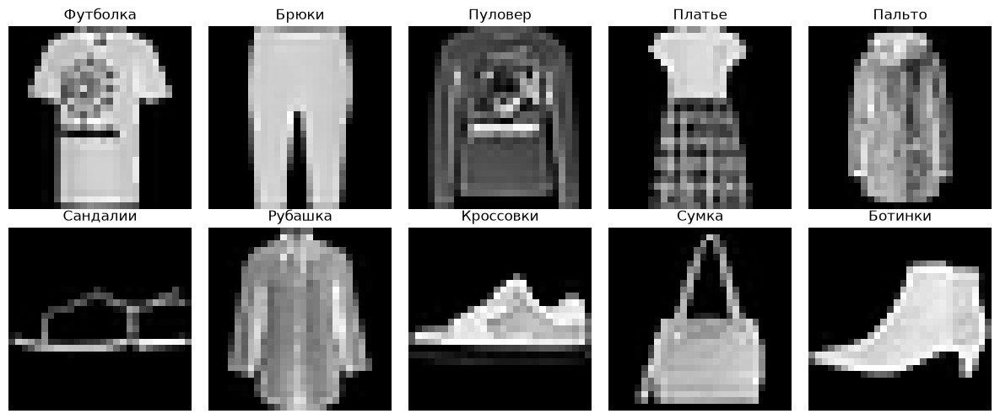

Показано по одному изображению каждого класса из Train. Светлые пиксели соответствуют большей интенсивности. Некоторые категории, например рубашка и футболка, имеют сходные контуры, что может приводить к ошибкам.

**Распределение классов**

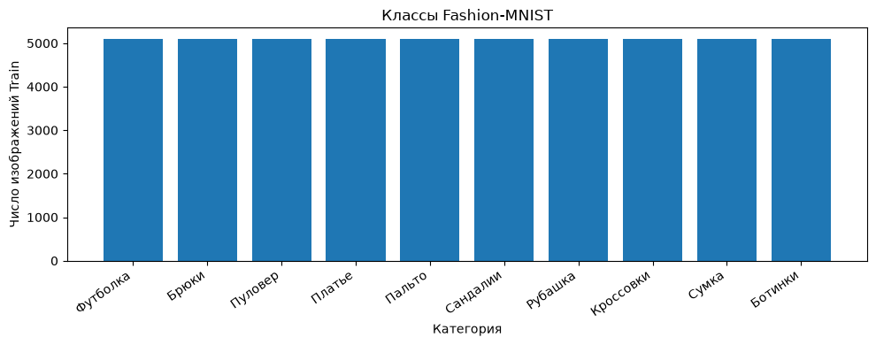

Высота каждого столбца — число обучающих изображений данной категории после очистки. Сравниваются доли классов; если они почти одинаковы, общая Accuracy более информативна, но индивидуальные метрики всё равно необходимы.

**Гистограмма интенсивности пикселей**

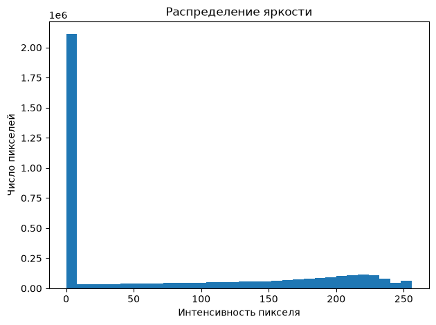

Для читаемости взят каждый десятый обучающий образец; все изображения участвуют в обучении. Ось X показывает яркость, ось Y — количество пикселей. Большой столбец около нуля связан с тёмным фоном.

**Средние изображения классов**

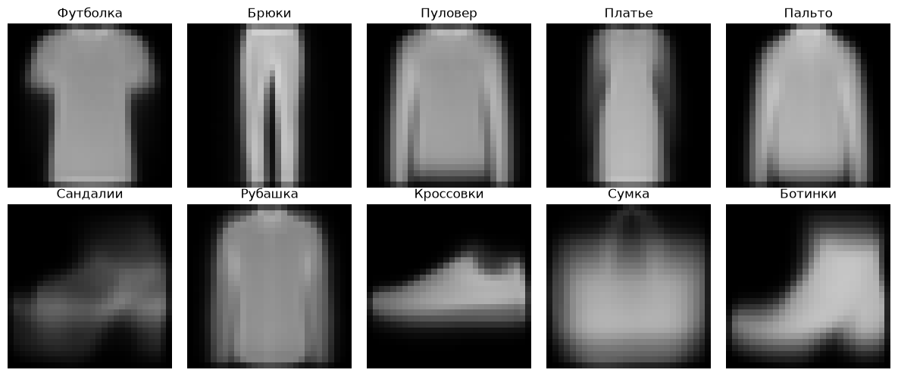

Для каждого класса рассчитано среднее изображение по всем его обучающим примерам. Яркие области показывают места, где предмет встречается чаще; размытость возникает из-за различий формы и положения.

**Диаграмма размаха яркости**

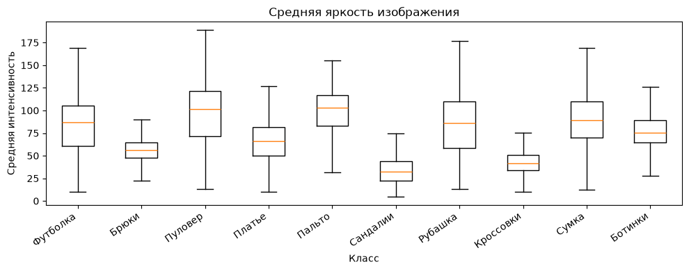

Линия в коробке — медиана средней яркости изображения, границы — квартили. Усы отражают разброс; крайние точки скрыты исключительно для читаемости, данные не удаляются. Категории могут отличаться площадью светлых областей.

**Корреляция характеристик изображений**

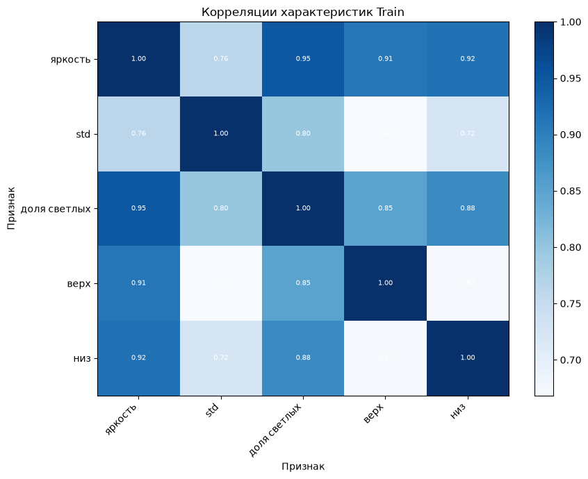

Матрица Пирсона показывает линейные связи между агрегированными характеристиками, например средней яркостью и долей светлых пикселей. Эти характеристики предназначены только для анализа; CNN получает исходные пиксельные массивы.

**Кривые функции потерь**

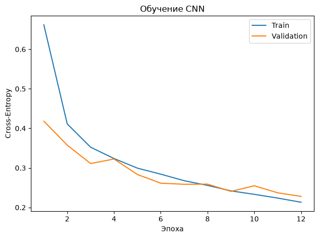

По оси X — эпохи, по Y — средняя ошибка. Разница между Train и Validation помогает обнаружить переобучение. Для Test использовано состояние с минимальной ошибкой Validation.

**Кривая точности валидации**

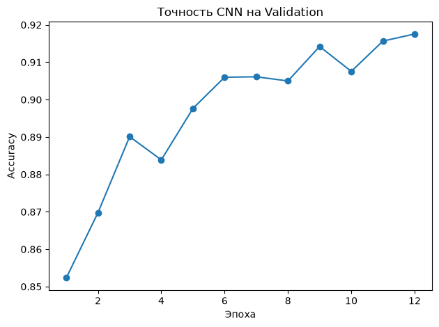

Каждая точка показывает долю верных предсказаний на Validation после эпохи. Рост и дальнейшее плато отражают изменение качества; это не тестовая метрика.

**Матрица ошибок**

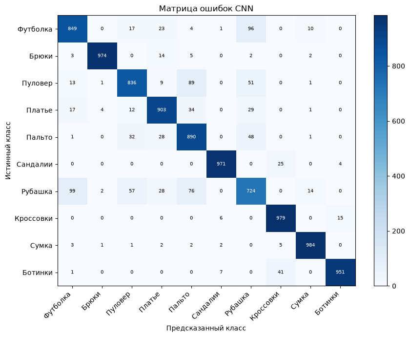

Строки — фактические классы, столбцы — прогноз. Диагональ содержит правильные ответы, остальные ячейки показывают, какие категории сеть путает.

**Метрики по классам**

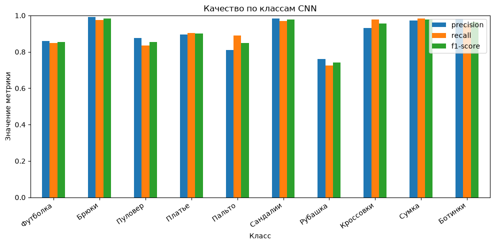

По трём столбцам для каждого класса сопоставляются полнота, точность и F1. Macro F1 не позволяет частому или лёгкому классу скрыть низкое качество остальных.

**Примеры ошибок классификации**

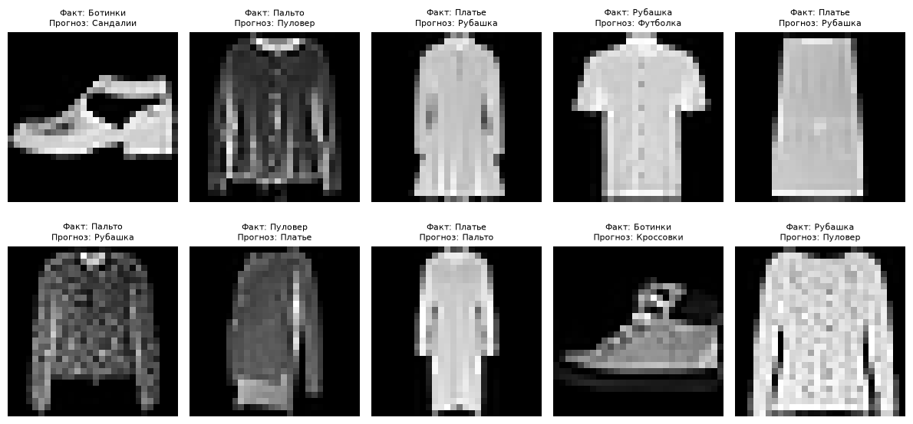

Показаны первые десять ошибочных предсказаний Test, если такие имеются. Подписи сравнивают реальные и предсказанные категории. По контурам можно увидеть возможные причины путаницы, но это не доказывает причину ошибки.

**Распределение уверенности**

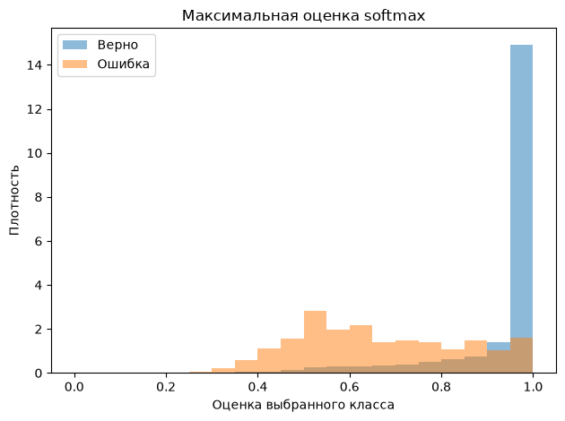

Максимум softmax — оценка уверенности в выбранном классе. Сопоставляются распределения для верных и ошибочных ответов. Высокая оценка не гарантирует правильность, а softmax сам по себе не является доказательством калибровки.

[Отдельная работа](../02_CNN/README.md)

### Рекуррентная нейронная сеть (RNN)

Для обучения сформировано 49066 временных окон (они перекрываются внутри Train). MAE=0.393 °C, RMSE=0.562 °C, R²=0.995. Базовый MAE=0.647 °C; по MAE сеть превосходит базовый прогноз.

**График временного ряда**

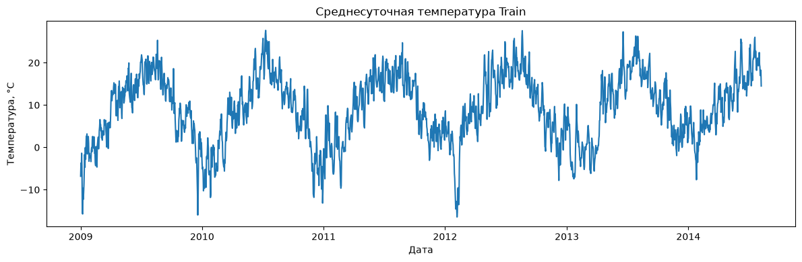

Линия показывает среднюю температуру каждого дня обучающего периода. Повторение подъёмов и спадов отражает годовую сезонность. Дневное усреднение применяется только для визуализации.

**Гистограмма температуры**

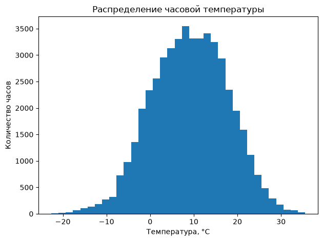

Высота столбца — число часов в заданном диапазоне температуры. По форме распределения судят о частых значениях и редких экстремумах.

**Диаграмма размаха по месяцам**

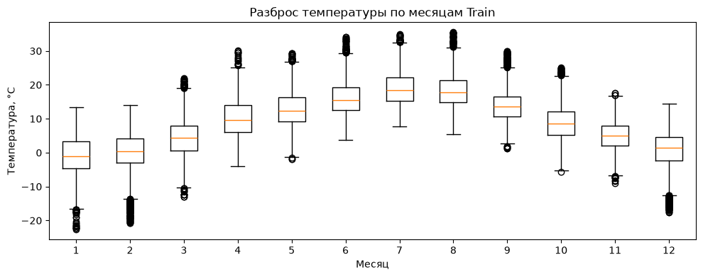

Каждая коробка характеризует центральные 50% температур данного месяца, центральная линия — медиана. Усы и точки отображают разброс температур; различие медиан характеризует сезонность.

**Суточный профиль**

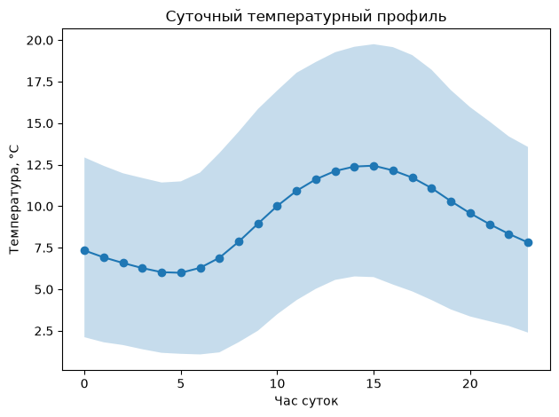

Линия соответствует средней температуре в каждый час суток, полоса — межквартильный диапазон. Часть изменения связана с суточным циклом; ширина полосы отражает сезонный и погодный разброс.

**Автокорреляционная функция**

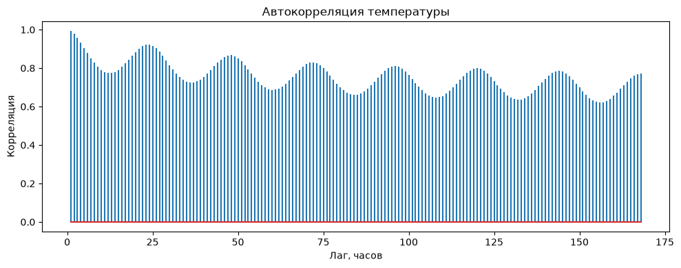

Для каждой задержки рассчитывается корреляция ряда с собственной сдвинутой копией. Пики на кратных 24 часам могут указывать на суточную периодичность. Используется только Train; пропуски учитываются попарно.

**Корреляционная матрица**

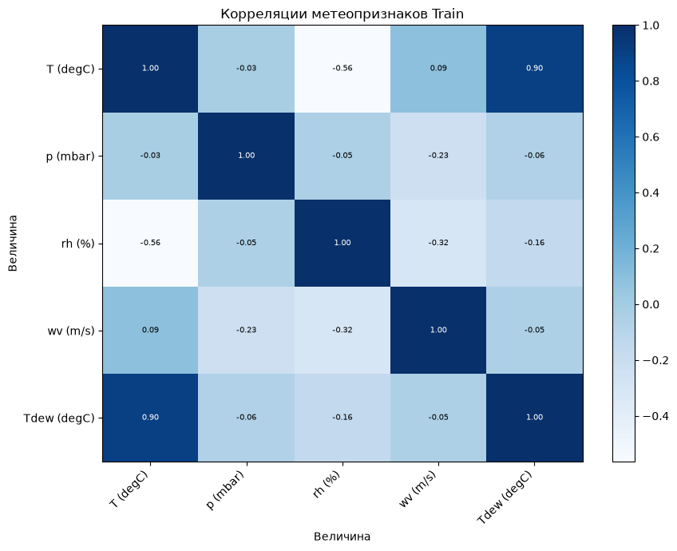

Ячейки показывают коэффициенты Пирсона между пятью погодными величинами. Корреляция описывает линейную связь, но не причинность. Сильная связь температуры и точки росы физически закономерна.

**Кривые функции потерь**

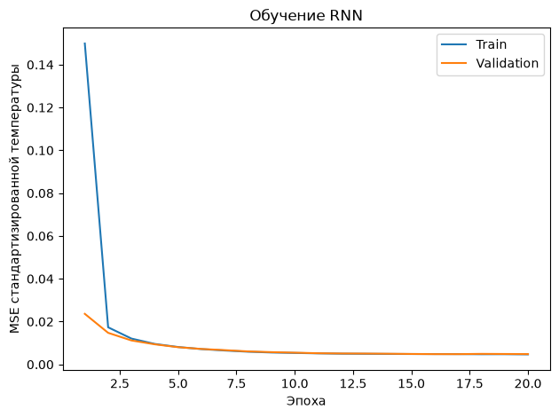

Кривые ошибки показывают, как меняется качество в процессе обучения. Выбор состояния сети производится по минимуму Validation MSE; Test не используется при подборе весов.

**Сопоставление прогнозов с фактом**

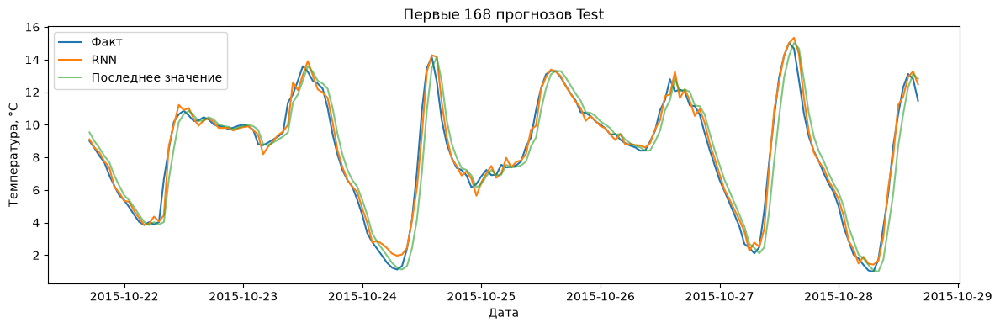

На графике показан начальный участок тестовых прогнозов. Совпадение линий отражает точность, а заметный сдвиг может указывать на запаздывание. Базовый прогноз позволяет оценить вклад сети по сравнению с простым правилом.

**Диаграмма фактических и предсказанных значений**

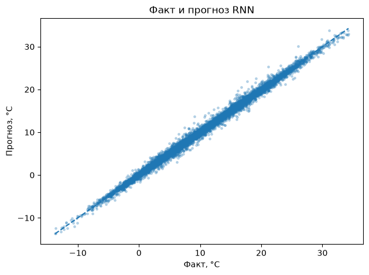

Каждая точка соответствует тестовому окну. Диагональ означает идеальное совпадение. Чем ближе облако к диагонали, тем меньше ошибка; отклонения выявляют систематические промахи при отдельных температурах.

**Гистограмма остатков**

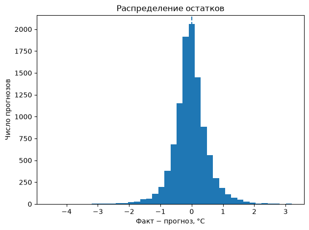

Положительный остаток означает занижение прогноза, отрицательный — завышение. Концентрация около нуля и симметрия дают представление о систематической ошибке; длинные хвосты показывают крупные промахи.

**Диаграмма остатков**

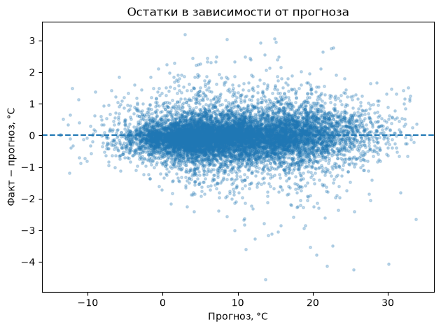

По X — рассчитанная температура, по Y — подписанная ошибка. Желательно отсутствие выраженной зависимости остатков от уровня прогноза. Изгиб или расширение облака может означать систематическую проблему модели.

**Сравнение ошибок с базовой моделью**

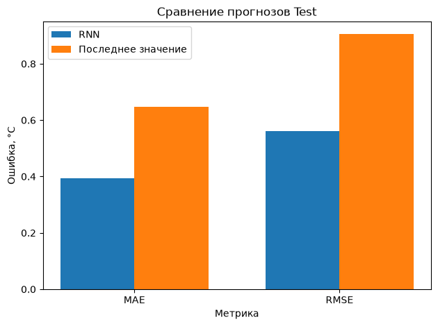

Сравниваются MAE и RMSE сети и базового прогноза на одних и тех же Test-окнах. Меньшая высота означает меньшую ошибку. Если RNN не выигрывает у базового метода, это ограничение необходимо отразить в выводе.

[Отдельная работа](../03_RNN/README.md)

## Общий вывод

Результаты трёх архитектур приведены с учётом специфики задач и независимых тестовых выборок.

[Общий ноутбук](00_practice_2_all_networks.ipynb) · [К практике](../README.md)
