# Полносвязная нейронная сеть (FCN)

[Главная](../../README.md) · [Практика №2](../README.md) · [Ноутбук](01_fcn_bank_marketing.ipynb) · [Общий ноутбук](../00_All_Models/README.md)

Цель работы — классификация клиентов банка по вероятности оформления срочного вклада. Был использован полный набор `bank-full.csv`, содержащий 45 211 записей до очистки. Выполняются анализ табличных данных, кодирование категориальных признаков, обучение полносвязной сети и оценка на отдельной тестовой выборке.

Источник: [UCI Bank Marketing](https://archive.ics.uci.edu/dataset/222/bank+marketing).

[Результаты](#results) · [Графики](#figures) · [Выводы](#conclusions)

## Результаты

Train / Validation / Test: **31 636 / 6 779 / 6 780**.

| Метрика на Test | Значение |
|---|---:|
| Accuracy | 0.7608 |
| Macro Precision | 0.6136 |
| Macro Recall | 0.7209 |
| Macro F1 | 0.6233 |
| Precision (yes) | 0.2810 |
| Recall (yes) | 0.6688 |
| ROC-AUC | 0.7878 |
| PR-AUC (AP) | 0.4174 |

## Графики

**Распределение классов**

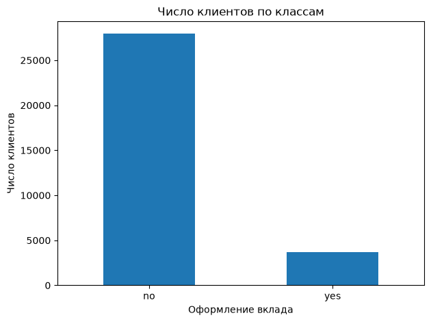

Столбцы показывают количество клиентов с ответами no и yes. Различие высот отражает дисбаланс; поэтому одной Accuracy недостаточно, используется Macro F1 и полнота положительного класса.

**Гистограмма возраста**

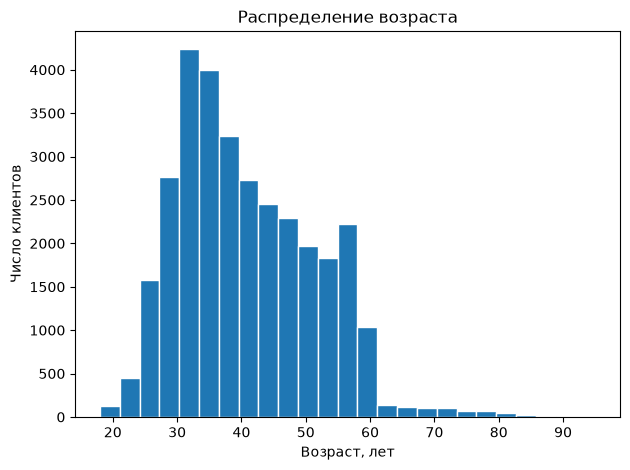

Гистограмма делит возраст на 25 интервалов. Высота столбца соответствует числу клиентов; по форме можно определить наиболее распространённый возраст и крайние группы.

**Диаграмма размаха баланса**

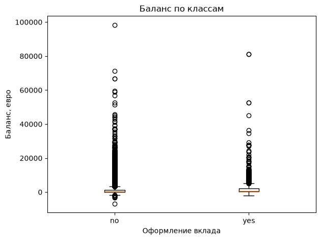

Линия внутри коробки — медиана, границы — первый и третий квартили; усы ограничены правилом 1,5 IQR. Точки вне усов могут быть реальными крупными суммами. Сопоставляются различия распределений двух классов.

**Эмпирическая функция распределения**

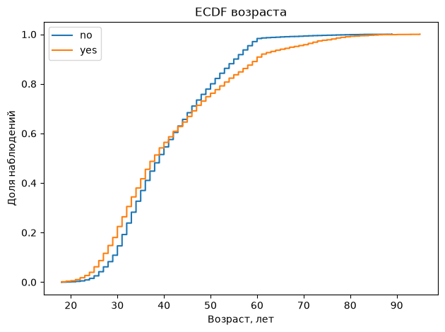

ECDF показывает долю клиентов с возрастом не больше значения по X. Расхождение кривых отражает различие распределений, но не устанавливает причинную связь.

**Диаграмма рассеяния**

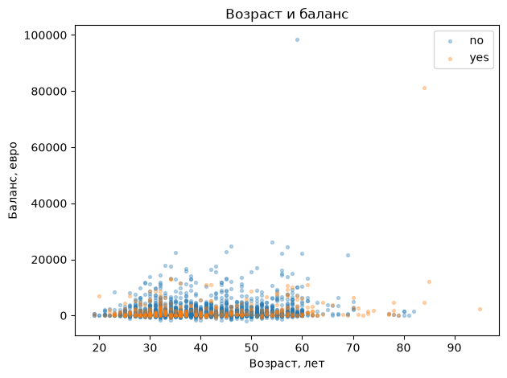

Каждая точка — одна запись из случайной подвыборки Train для читаемости. Перекрытие цветов показывает, почему двух признаков может быть недостаточно для разделения классов. Обучение использует всю Train.

**Корреляционная матрица**

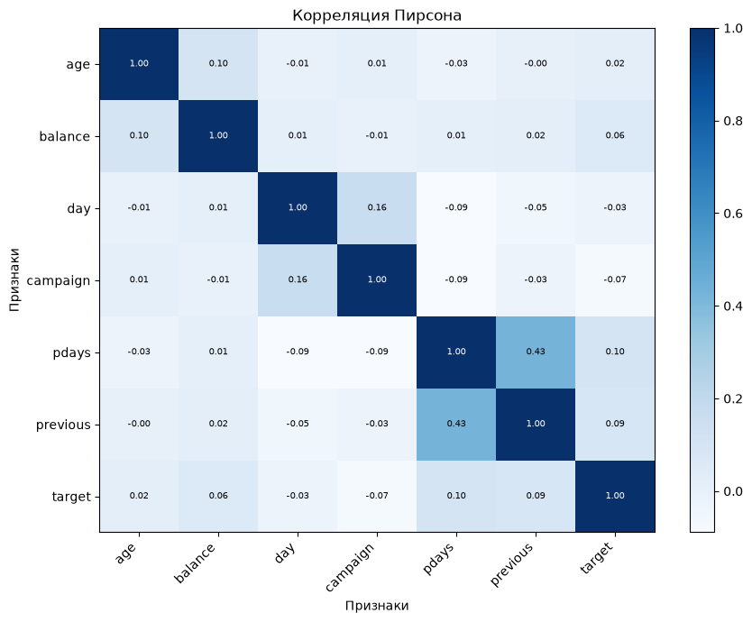

Коэффициенты от −1 до 1 характеризуют линейную связь числовых признаков. Диагональ равна единице для непостоянных признаков; отрицательные значения не означают слабую связь. Корреляция не доказывает причинность.

**Кривые функции потерь**

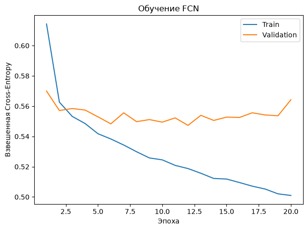

Снижение обеих кривых указывает на уменьшение ошибки. Рост Validation при дальнейшем падении Train может свидетельствовать о переобучении; выбор весов выполнялся по минимуму Validation.

**Матрица ошибок**

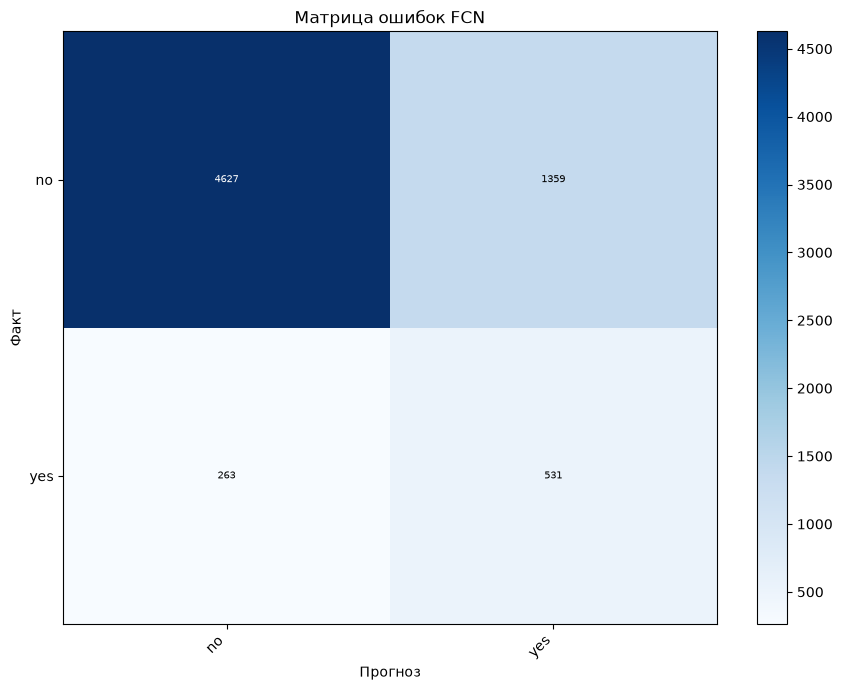

На диагонали — верные ответы. Верхняя правая клетка — ошибочное предсказание вклада, нижняя левая — пропущенный вклад. Числа дают абсолютное количество ошибок.

**ROC-кривая**

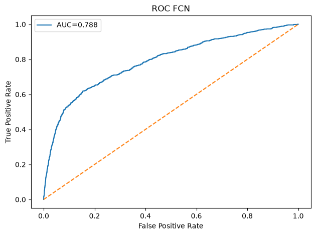

Кривая показывает компромисс между долей ложных срабатываний и долей найденных положительных объектов при разных порогах. Чем ближе линия к левому верхнему углу, тем лучше ранжирование.

**Кривая Precision–Recall**

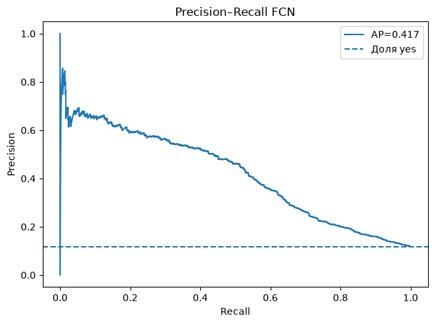

PR-кривая особенно полезна для редкого положительного класса. Пунктир показывает долю положительных объектов, а AP характеризует качество ранжирования по precision и recall.

**Распределение оценок модели**

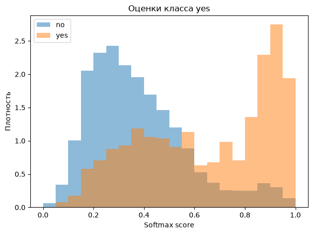

По оси X — оценка принадлежности к yes, по Y — нормированная плотность. Перекрытие отражает неоднозначные случаи; взвешенная функция потерь может влиять на калибровку вероятностей.

**Метрики по классам**

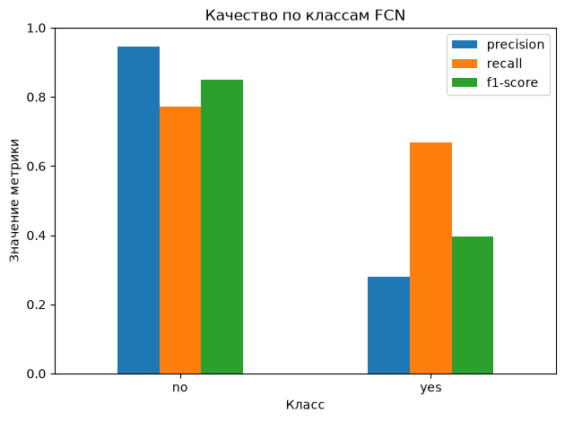

Группы столбцов сравнивают качество для каждого класса. Низкий Recall класса yes означает пропущенные вклады. Macro F1 усредняет F1 классов без учёта их численности.

## Выводы

После очистки для обучения использовано 31636 клиентов. Accuracy=0.761, Macro F1=0.623, Recall yes=0.669; ROC-AUC=0.788. При дисбалансе следует учитывать полноту класса yes, а не только общую точность.

[Полный ноутбук](01_fcn_bank_marketing.ipynb) · [К практике](../README.md) · [На главную](../../README.md)
