# Свёрточная нейронная сеть (CNN)

[Главная](../../README.md) · [Практика №2](../README.md) · [Ноутбук](02_cnn_fashion_mnist.ipynb) · [Общий ноутбук](../00_All_Models/README.md)

Цель работы — распознавание десяти видов одежды и обуви по полутоновым изображениям 28×28. Используется полный Fashion-MNIST: 60 000 исходных обучающих и 10 000 тестовых изображений. После проверки изображений выделяется Validation из исходного Train; официальный Test остаётся отдельным.

Источник: [Fashion-MNIST, Zalando Research](https://github.com/zalandoresearch/fashion-mnist).

[Результаты](#results) · [Графики](#figures) · [Выводы](#conclusions)

## Результаты

Train / Validation / Test: **51 000 / 9 000 / 10 000**.

| Метрика на Test | Значение |
|---|---:|
| Accuracy | 0.9061 |
| Macro Precision | 0.9064 |
| Macro Recall | 0.9061 |
| Macro F1 | 0.9059 |

## Графики

**Примеры изображений**

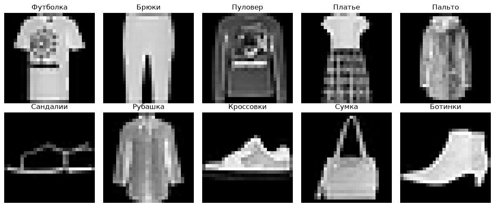

Показано по одному изображению каждого класса из Train. Светлые пиксели соответствуют большей интенсивности. Некоторые категории, например рубашка и футболка, имеют сходные контуры, что может приводить к ошибкам.

**Распределение классов**

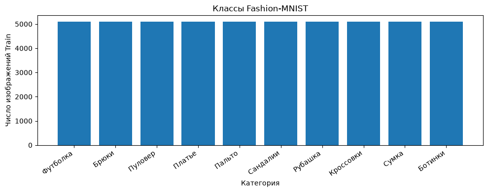

Высота каждого столбца — число обучающих изображений данной категории после очистки. Сравниваются доли классов; если они почти одинаковы, общая Accuracy более информативна, но индивидуальные метрики всё равно необходимы.

**Гистограмма интенсивности пикселей**

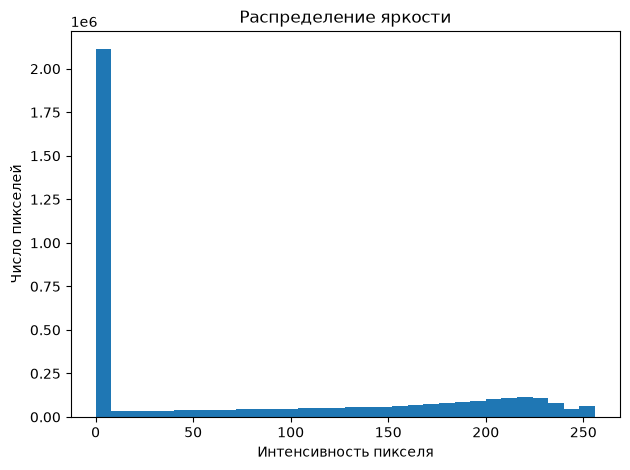

Для читаемости взят каждый десятый обучающий образец; все изображения участвуют в обучении. Ось X показывает яркость, ось Y — количество пикселей. Большой столбец около нуля связан с тёмным фоном.

**Средние изображения классов**

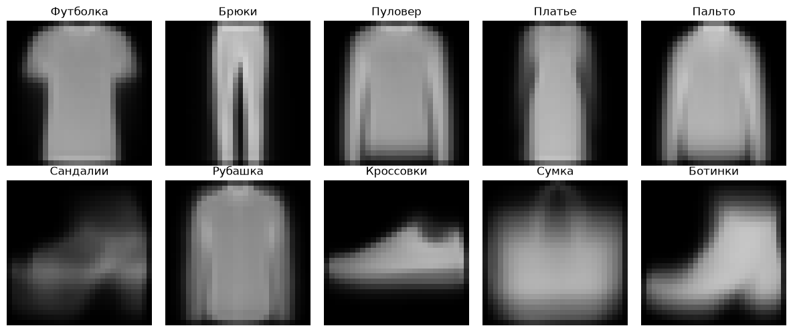

Для каждого класса рассчитано среднее изображение по всем его обучающим примерам. Яркие области показывают места, где предмет встречается чаще; размытость возникает из-за различий формы и положения.

**Диаграмма размаха яркости**

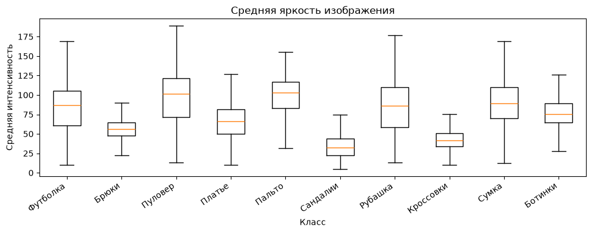

Линия в коробке — медиана средней яркости изображения, границы — квартили. Усы отражают разброс; крайние точки скрыты исключительно для читаемости, данные не удаляются. Категории могут отличаться площадью светлых областей.

**Корреляция характеристик изображений**

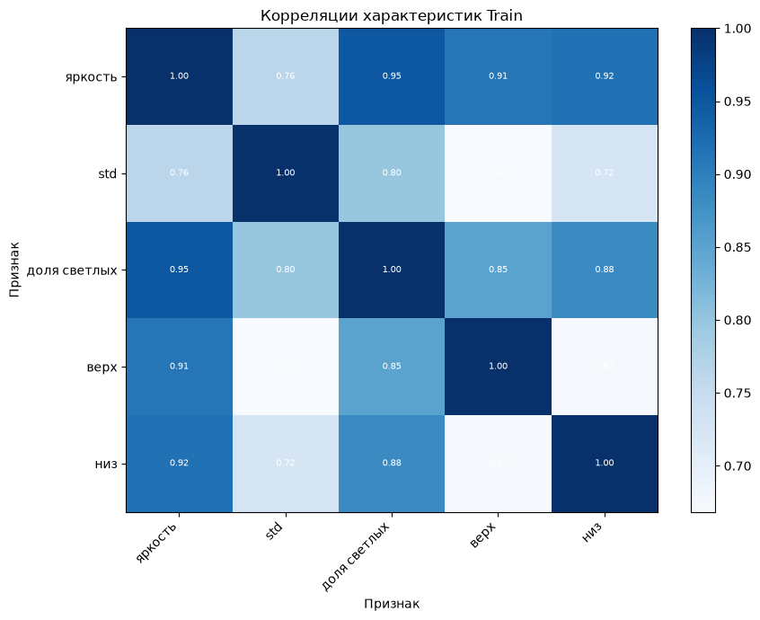

Матрица Пирсона показывает линейные связи между агрегированными характеристиками, например средней яркостью и долей светлых пикселей. Эти характеристики предназначены только для анализа; CNN получает исходные пиксельные массивы.

**Кривые функции потерь**

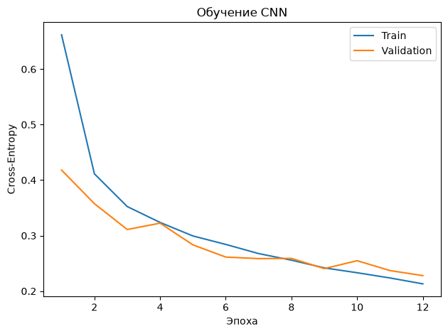

По оси X — эпохи, по Y — средняя ошибка. Разница между Train и Validation помогает обнаружить переобучение. Для Test использовано состояние с минимальной ошибкой Validation.

**Кривая точности валидации**

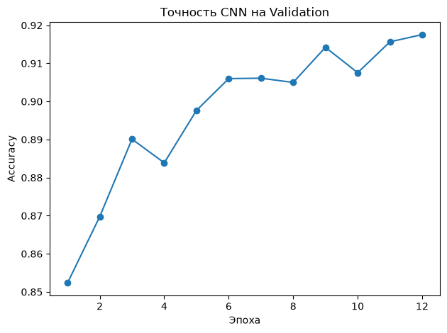

Каждая точка показывает долю верных предсказаний на Validation после эпохи. Рост и дальнейшее плато отражают изменение качества; это не тестовая метрика.

**Матрица ошибок**

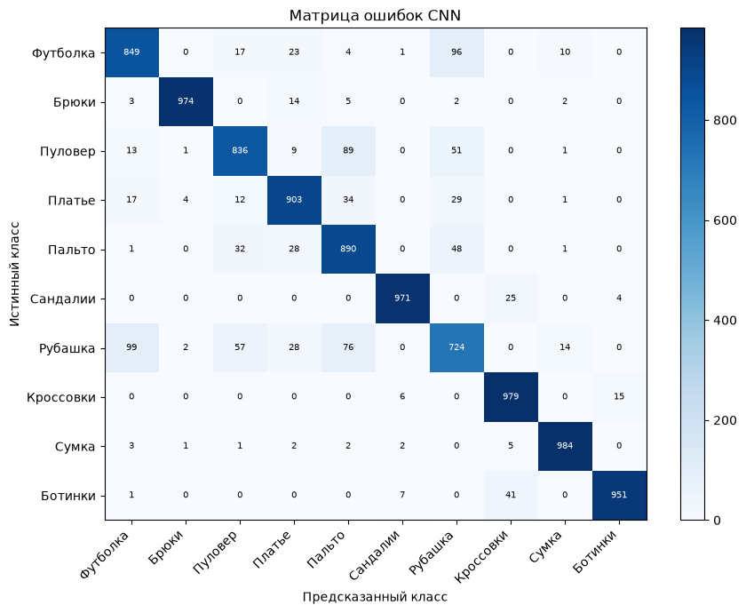

Строки — фактические классы, столбцы — прогноз. Диагональ содержит правильные ответы, остальные ячейки показывают, какие категории сеть путает.

**Метрики по классам**

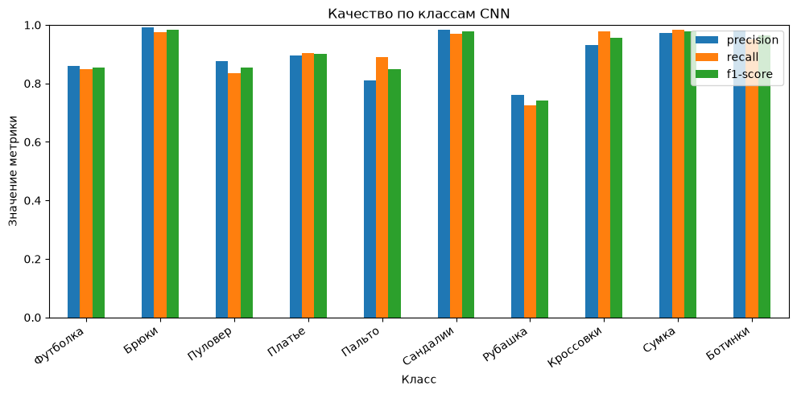

По трём столбцам для каждого класса сопоставляются полнота, точность и F1. Macro F1 не позволяет частому или лёгкому классу скрыть низкое качество остальных.

**Примеры ошибок классификации**

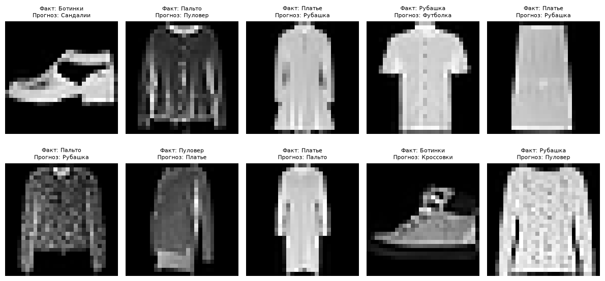

Показаны первые десять ошибочных предсказаний Test, если такие имеются. Подписи сравнивают реальные и предсказанные категории. По контурам можно увидеть возможные причины путаницы, но это не доказывает причину ошибки.

**Распределение уверенности**

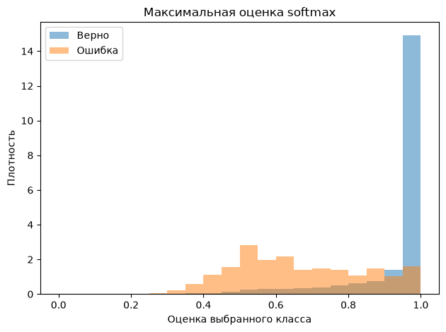

Максимум softmax — оценка уверенности в выбранном классе. Сопоставляются распределения для верных и ошибочных ответов. Высокая оценка не гарантирует правильность, а softmax сам по себе не является доказательством калибровки.

## Выводы

Для обучения CNN использовано 51000 отдельных изображений. На Test получены Accuracy=0.906 и Macro F1=0.906. Матрица ошибок и метрики по классам позволяют оценить различия в распознавании категорий.

[Полный ноутбук](02_cnn_fashion_mnist.ipynb) · [К практике](../README.md) · [На главную](../../README.md)
