# Рекуррентная нейронная сеть (RNN)

[Главная](../../README.md) · [Практика №2](../README.md) · [Ноутбук](03_rnn_jena_climate.ipynb) · [Общий ноутбук](../00_All_Models/README.md)

Цель — прогноз температуры воздуха на один час вперёд по метеорологическим измерениям за предыдущие 24 часа. Исходный ряд содержит около 420 тыс. десятиминутных измерений; для работы формируются средние часовые значения. Разбиение хронологическое, без случайного перемешивания временных интервалов.

Источник: [Jena Climate / Keras](https://keras.io/examples/timeseries/timeseries_weather_forecasting/).

[Результаты](#results) · [Графики](#figures) · [Выводы](#conclusions)

## Результаты

Train / Validation / Test: **49 066 / 10 428 / 10 397**.

| Метрика на Test | Значение |
|---|---:|
| MAE (°C) | 0.3929 |
| RMSE (°C) | 0.5616 |
| R2 | 0.9948 |
| Baseline MAE (°C) | 0.6475 |
| Baseline RMSE (°C) | 0.9049 |

## Графики

**График временного ряда**

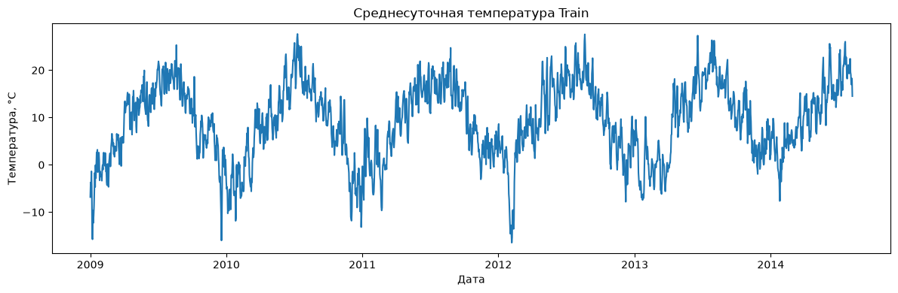

Линия показывает среднюю температуру каждого дня обучающего периода. Повторение подъёмов и спадов отражает годовую сезонность. Дневное усреднение применяется только для визуализации.

**Гистограмма температуры**

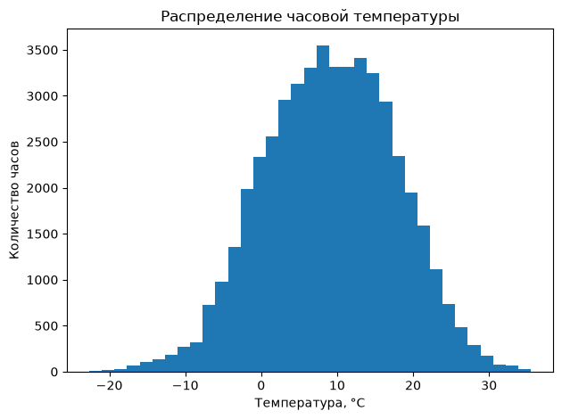

Высота столбца — число часов в заданном диапазоне температуры. По форме распределения судят о частых значениях и редких экстремумах.

**Диаграмма размаха по месяцам**

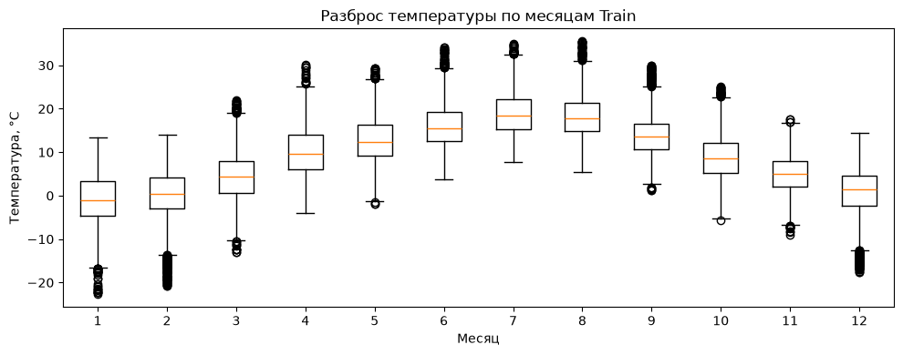

Каждая коробка характеризует центральные 50% температур данного месяца, центральная линия — медиана. Усы и точки отображают разброс температур; различие медиан характеризует сезонность.

**Суточный профиль**

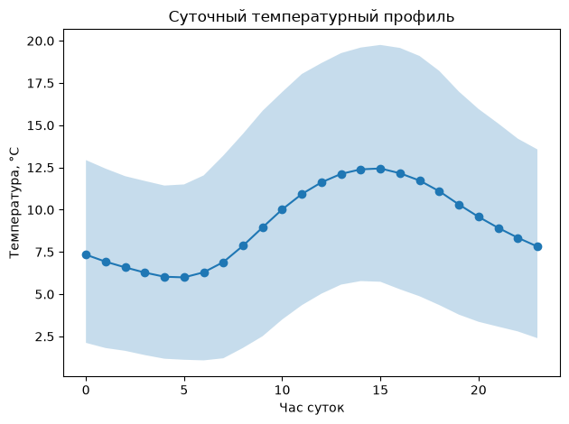

Линия соответствует средней температуре в каждый час суток, полоса — межквартильный диапазон. Часть изменения связана с суточным циклом; ширина полосы отражает сезонный и погодный разброс.

**Автокорреляционная функция**

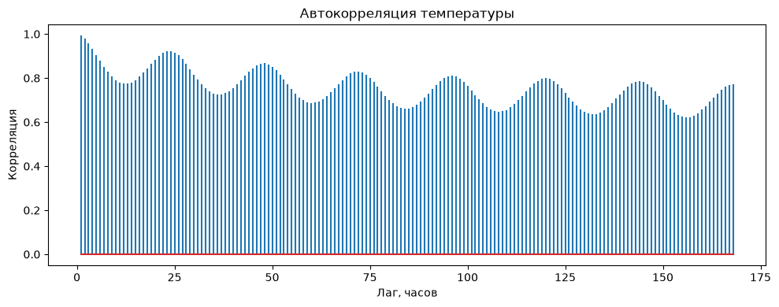

Для каждой задержки рассчитывается корреляция ряда с собственной сдвинутой копией. Пики на кратных 24 часам могут указывать на суточную периодичность. Используется только Train; пропуски учитываются попарно.

**Корреляционная матрица**

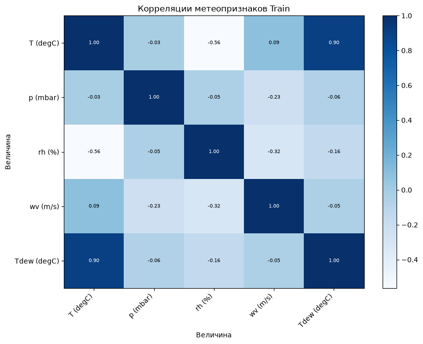

Ячейки показывают коэффициенты Пирсона между пятью погодными величинами. Корреляция описывает линейную связь, но не причинность. Сильная связь температуры и точки росы физически закономерна.

**Кривые функции потерь**

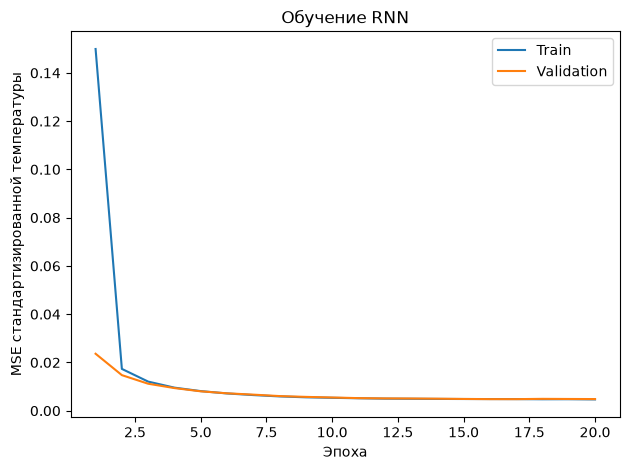

Кривые ошибки показывают, как меняется качество в процессе обучения. Выбор состояния сети производится по минимуму Validation MSE; Test не используется при подборе весов.

**Сопоставление прогнозов с фактом**

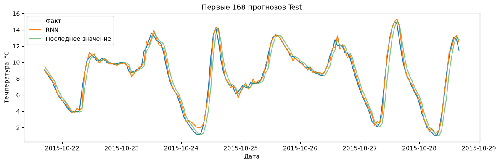

На графике показан начальный участок тестовых прогнозов. Совпадение линий отражает точность, а заметный сдвиг может указывать на запаздывание. Базовый прогноз позволяет оценить вклад сети по сравнению с простым правилом.

**Диаграмма фактических и предсказанных значений**

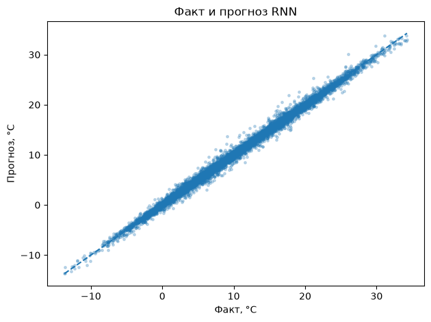

Каждая точка соответствует тестовому окну. Диагональ означает идеальное совпадение. Чем ближе облако к диагонали, тем меньше ошибка; отклонения выявляют систематические промахи при отдельных температурах.

**Гистограмма остатков**

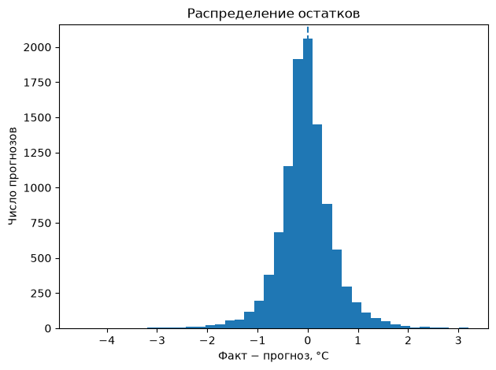

Положительный остаток означает занижение прогноза, отрицательный — завышение. Концентрация около нуля и симметрия дают представление о систематической ошибке; длинные хвосты показывают крупные промахи.

**Диаграмма остатков**

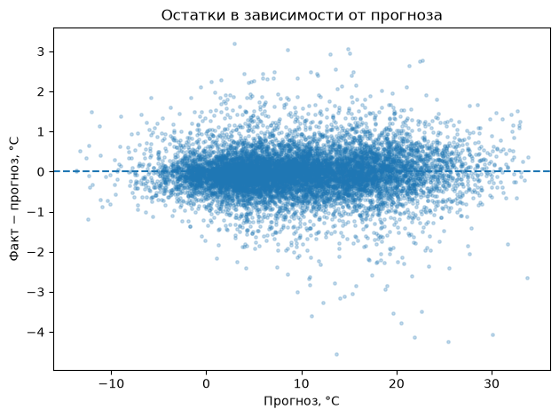

По X — рассчитанная температура, по Y — подписанная ошибка. Желательно отсутствие выраженной зависимости остатков от уровня прогноза. Изгиб или расширение облака может означать систематическую проблему модели.

**Сравнение ошибок с базовой моделью**

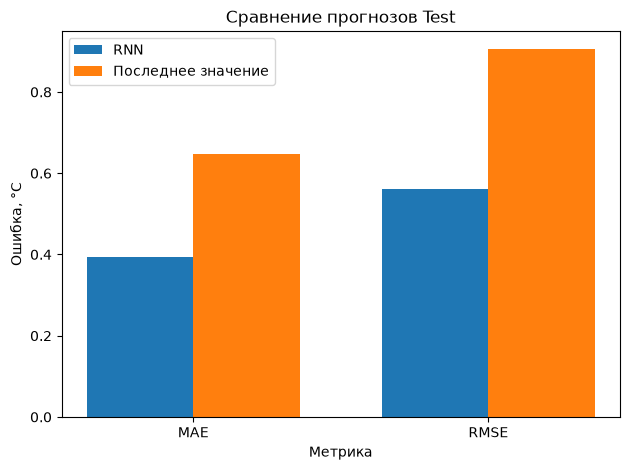

Сравниваются MAE и RMSE сети и базового прогноза на одних и тех же Test-окнах. Меньшая высота означает меньшую ошибку. Если RNN не выигрывает у базового метода, это ограничение необходимо отразить в выводе.

## Выводы

Для обучения сформировано 49066 временных окон (они перекрываются внутри Train). MAE=0.393 °C, RMSE=0.562 °C, R²=0.995. Базовый MAE=0.647 °C; по MAE сеть превосходит базовый прогноз.

[Полный ноутбук](03_rnn_jena_climate.ipynb) · [К практике](../README.md) · [На главную](../../README.md)
