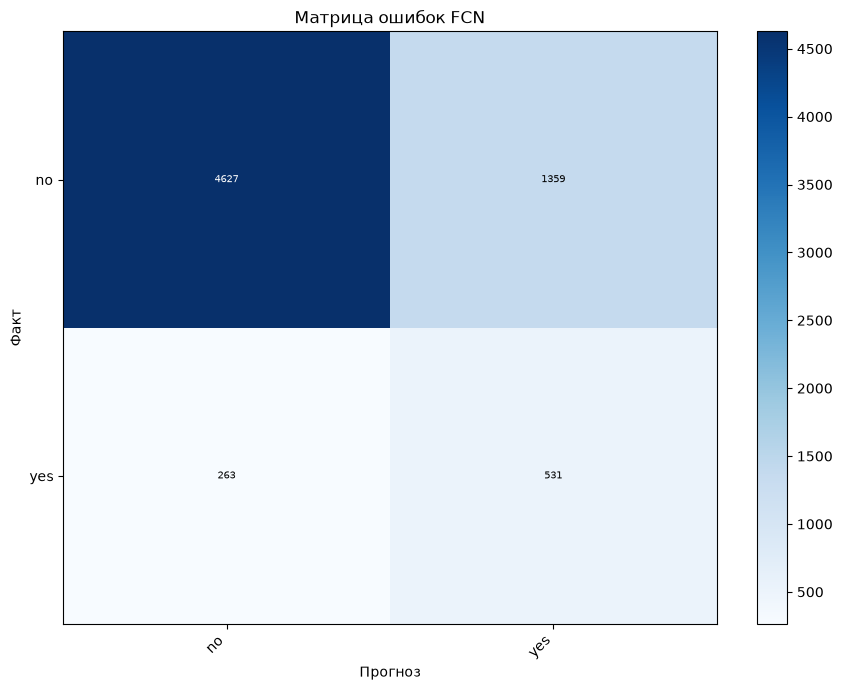
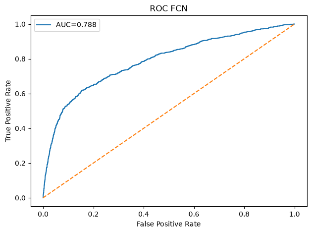
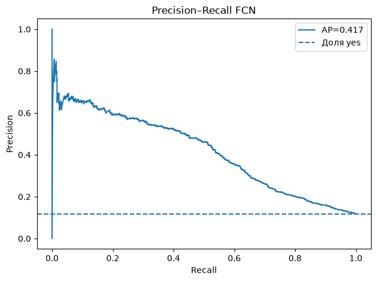
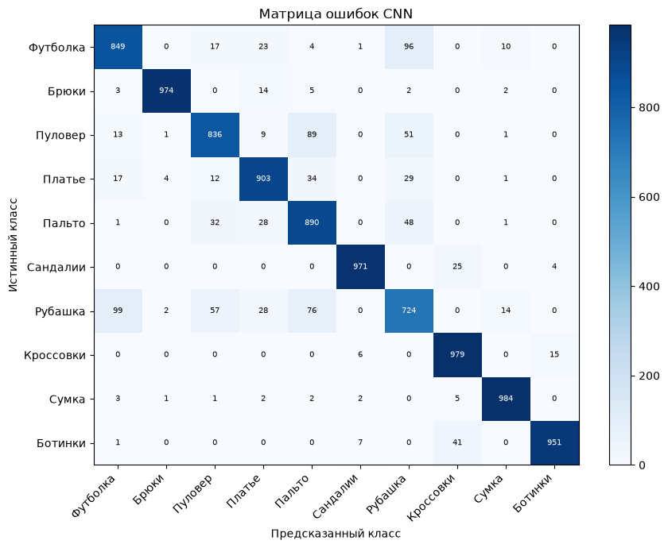
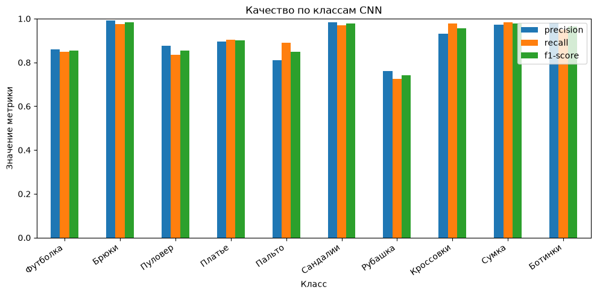
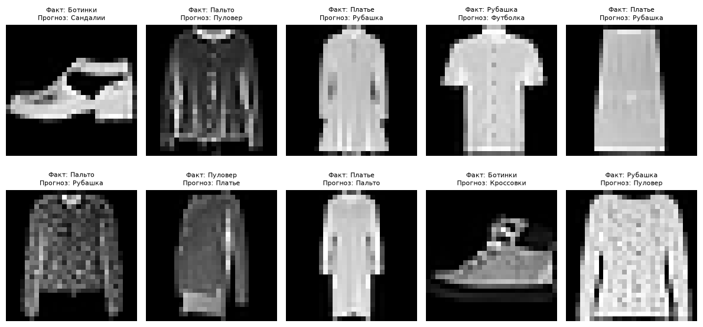
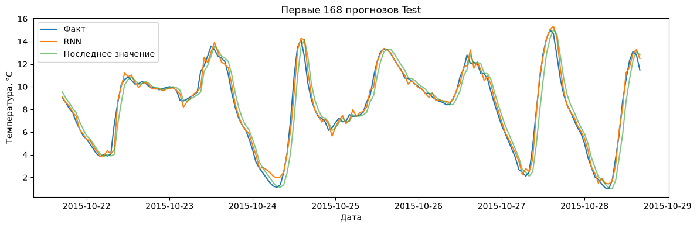
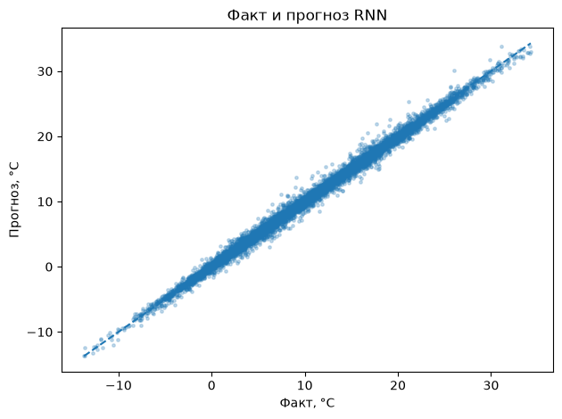
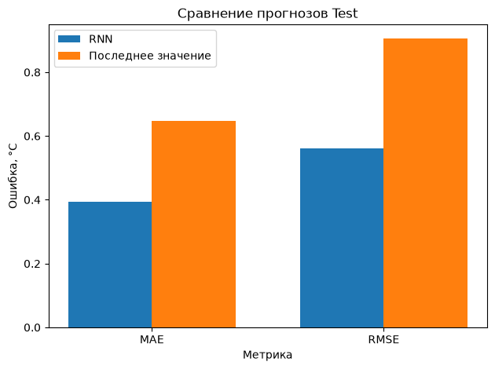

# Практическая работа №2. Базовые архитектуры нейронных сетей

[Главная страница](../README.md) · [Результаты](#results) · [Графики](#figures) · [Выводы](#conclusions) · [Общий ноутбук](00_All_Models/README.md)

Были рассмотрены три архитектуры: полносвязная сеть для табличных данных, свёрточная для изображений и рекуррентная для временного ряда. Для каждого обучения использовано не менее 20 000 примеров Train. Данные Validation и Test не использовались для обновления весов.

## Сводные результаты

| Модель | Датасет | Train / Validation / Test | Метрики Test | Графики |
|---|---|---:|---|---:|
| [Полносвязная нейронная сеть (FCN)](01_FCN/README.md) · [Код](01_FCN/01_fcn_bank_marketing.ipynb) | [UCI Bank Marketing](https://archive.ics.uci.edu/dataset/222/bank+marketing) | 31 636 / 6 779 / 6 780 | Accuracy: 0.761; Macro Precision: 0.614; Macro Recall: 0.721; Macro F1: 0.623; Precision (yes): 0.281; Recall (yes): 0.669; ROC-AUC: 0.788; PR-AUC (AP): 0.417 | [12](01_FCN/README.md#figures) |
| [Свёрточная нейронная сеть (CNN)](02_CNN/README.md) · [Код](02_CNN/02_cnn_fashion_mnist.ipynb) | [Fashion-MNIST, Zalando Research](https://github.com/zalandoresearch/fashion-mnist) | 51 000 / 9 000 / 10 000 | Accuracy: 0.906; Macro Precision: 0.906; Macro Recall: 0.906; Macro F1: 0.906 | [12](02_CNN/README.md#figures) |
| [Рекуррентная нейронная сеть (RNN)](03_RNN/README.md) · [Код](03_RNN/03_rnn_jena_climate.ipynb) | [Jena Climate / Keras](https://keras.io/examples/timeseries/timeseries_weather_forecasting/) | 49 066 / 10 428 / 10 397 | MAE (°C): 0.393; RMSE (°C): 0.562; R2: 0.995; Baseline MAE (°C): 0.647; Baseline RMSE (°C): 0.905 | [12](03_RNN/README.md#figures) |

## Основные графики

### Полносвязная нейронная сеть (FCN)

После очистки для обучения использовано 31636 клиентов. Accuracy=0.761, Macro F1=0.623, Recall yes=0.669; ROC-AUC=0.788. При дисбалансе следует учитывать полноту класса yes, а не только общую точность.

**Матрица ошибок**

На диагонали — верные ответы. Верхняя правая клетка — ошибочное предсказание вклада, нижняя левая — пропущенный вклад. Числа дают абсолютное количество ошибок.

**ROC-кривая**

Кривая показывает компромисс между долей ложных срабатываний и долей найденных положительных объектов при разных порогах. Чем ближе линия к левому верхнему углу, тем лучше ранжирование.

**Кривая Precision–Recall**

PR-кривая особенно полезна для редкого положительного класса. Пунктир показывает долю положительных объектов, а AP характеризует качество ранжирования по precision и recall.

[Все 12 графиков и пояснения](01_FCN/README.md#figures) · [Ноутбук](01_FCN/01_fcn_bank_marketing.ipynb)

### Свёрточная нейронная сеть (CNN)

Для обучения CNN использовано 51000 отдельных изображений. На Test получены Accuracy=0.906 и Macro F1=0.906. Матрица ошибок и метрики по классам позволяют оценить различия в распознавании категорий.

**Матрица ошибок**

Строки — фактические классы, столбцы — прогноз. Диагональ содержит правильные ответы, остальные ячейки показывают, какие категории сеть путает.

**Метрики по классам**

По трём столбцам для каждого класса сопоставляются полнота, точность и F1. Macro F1 не позволяет частому или лёгкому классу скрыть низкое качество остальных.

**Примеры ошибок классификации**

Показаны первые десять ошибочных предсказаний Test, если такие имеются. Подписи сравнивают реальные и предсказанные категории. По контурам можно увидеть возможные причины путаницы, но это не доказывает причину ошибки.

[Все 12 графиков и пояснения](02_CNN/README.md#figures) · [Ноутбук](02_CNN/02_cnn_fashion_mnist.ipynb)

### Рекуррентная нейронная сеть (RNN)

Для обучения сформировано 49066 временных окон (они перекрываются внутри Train). MAE=0.393 °C, RMSE=0.562 °C, R²=0.995. Базовый MAE=0.647 °C; по MAE сеть превосходит базовый прогноз.

**Сопоставление прогнозов с фактом**

На графике показан начальный участок тестовых прогнозов. Совпадение линий отражает точность, а заметный сдвиг может указывать на запаздывание. Базовый прогноз позволяет оценить вклад сети по сравнению с простым правилом.

**Диаграмма фактических и предсказанных значений**

Каждая точка соответствует тестовому окну. Диагональ означает идеальное совпадение. Чем ближе облако к диагонали, тем меньше ошибка; отклонения выявляют систематические промахи при отдельных температурах.

**Сравнение ошибок с базовой моделью**

Сравниваются MAE и RMSE сети и базового прогноза на одних и тех же Test-окнах. Меньшая высота означает меньшую ошибку. Если RNN не выигрывает у базового метода, это ограничение необходимо отразить в выводе.

[Все 12 графиков и пояснения](03_RNN/README.md#figures) · [Ноутбук](03_RNN/03_rnn_jena_climate.ipynb)

## Общий вывод

Получены результаты на трёх отдельных задачах. Метрики классификации и регрессии нельзя непосредственно сравнивать между собой. Для временного ряда дополнительно проведено сравнение с прогнозом последнего значения. Подробные результаты приведены выше.

[Главная](../README.md)
