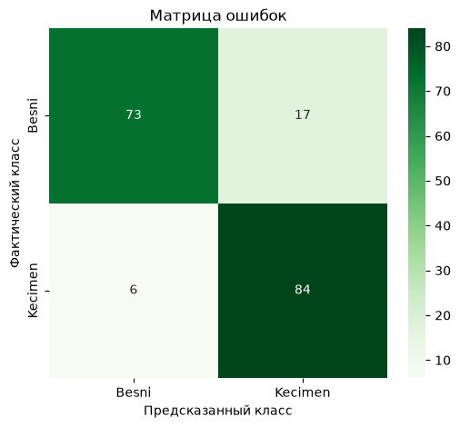
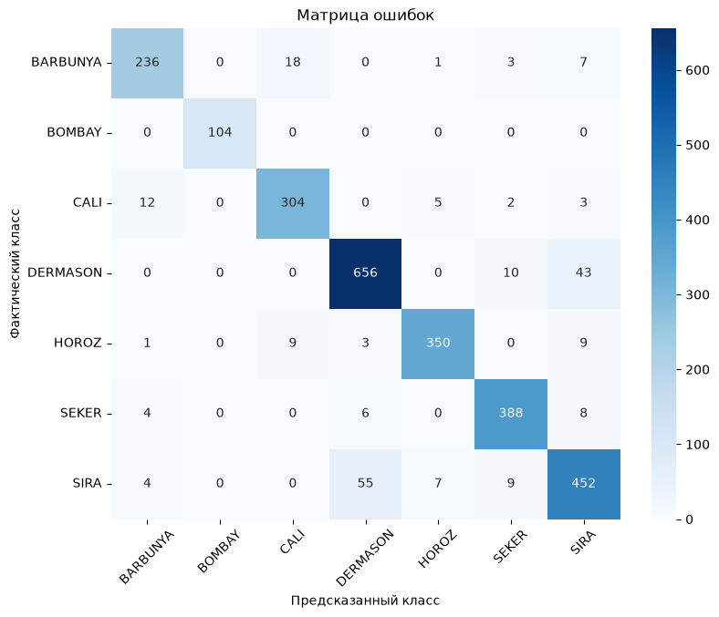
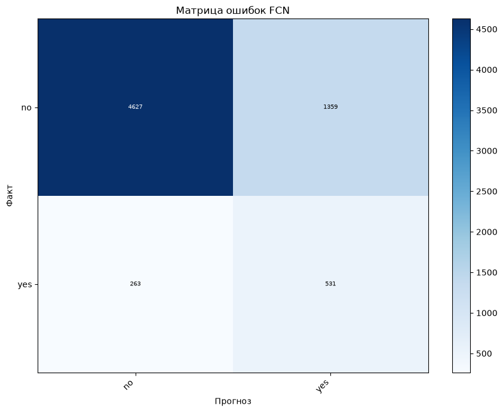
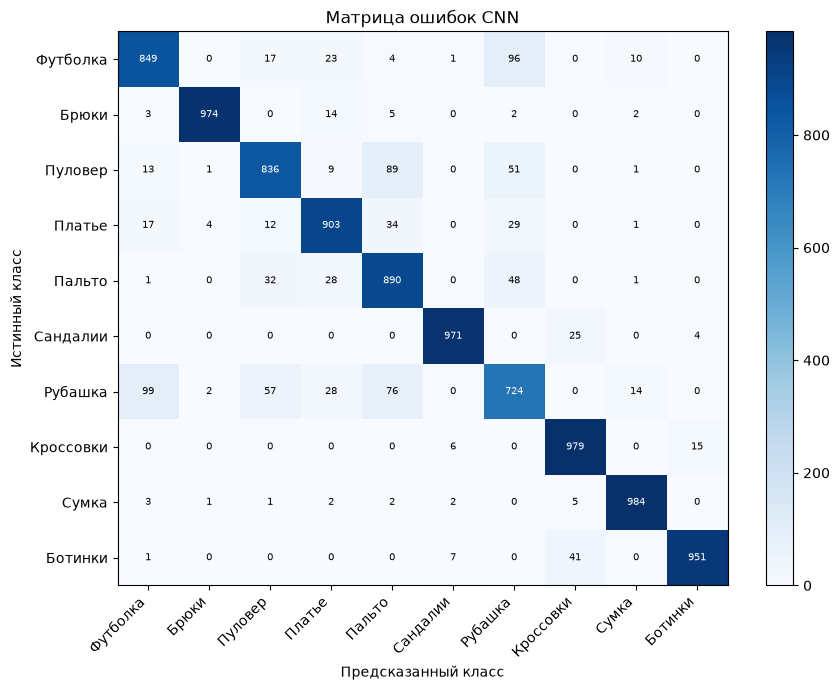
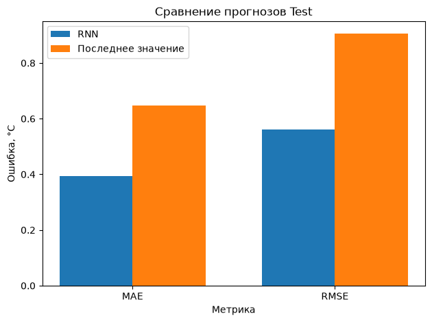

# Практические работы по методам машинного обучения

**ФИО студента:** Белый Максим Сергеевич

**Дисциплина:** Методы машинного обучения

## Описание проекта

В работах рассмотрены классические алгоритмы машинного обучения и базовые архитектуры нейронных сетей. Для каждой модели был выбран отдельный набор данных. В ноутбуках представлены проверка и подготовка данных, разведочный анализ, обучение моделей и оценка качества на тестовой выборке. Для второй практики предусмотрено обучение на выборках объёмом не менее 20 000 примеров.

[Содержание и результаты](#results) · [Основные графики](#figures) · [Общий вывод](#conclusions)

## Содержание и результаты

### [Практическая работа №1. Классические алгоритмы машинного обучения](Practice_1/README.md)

| Модель | Датасет | Метрики | Графики |
|---|---|---|---:|
| [Линейная регрессия](Practice_1/01_Linear_Regression/README.md) · [Ноутбук](Practice_1/01_Linear_Regression/01_%D0%9B%D0%B8%D0%BD%D0%B5%D0%B9%D0%BD%D0%B0%D1%8F_%D1%80%D0%B5%D0%B3%D1%80%D0%B5%D1%81%D1%81%D0%B8%D1%8F_Auto_MPG.ipynb) | Auto MPG | MAE, RMSE, R² | [15](Practice_1/01_Linear_Regression/README.md#figures) |
| [Логистическая регрессия](Practice_1/02_Logistic_Regression/README.md) · [Ноутбук](Practice_1/02_Logistic_Regression/02_%D0%9B%D0%BE%D0%B3%D0%B8%D1%81%D1%82%D0%B8%D1%87%D0%B5%D1%81%D0%BA%D0%B0%D1%8F_%D1%80%D0%B5%D0%B3%D1%80%D0%B5%D1%81%D1%81%D0%B8%D1%8F_Banknote.ipynb) | Banknote Authentication | Accuracy, Precision, Recall, F1, ROC-AUC | [16](Practice_1/02_Logistic_Regression/README.md#figures) |
| [Дерево решений](Practice_1/03_Decision_Tree/README.md) · [Ноутбук](Practice_1/03_Decision_Tree/03_%D0%94%D0%B5%D1%80%D0%B5%D0%B2%D0%BE_%D1%80%D0%B5%D1%88%D0%B5%D0%BD%D0%B8%D0%B9_Raisin.ipynb) | Raisin | Accuracy, Precision, Recall, F1 | [16](Practice_1/03_Decision_Tree/README.md#figures) |
| [Случайный лес](Practice_1/04_Random_Forest/README.md) · [Ноутбук](Practice_1/04_Random_Forest/04_%D0%A1%D0%BB%D1%83%D1%87%D0%B0%D0%B9%D0%BD%D1%8B%D0%B9_%D0%BB%D0%B5%D1%81_Dry_Bean.ipynb) | Dry Bean | Accuracy, Macro Precision, Macro Recall, Macro F1 | [16](Practice_1/04_Random_Forest/README.md#figures) |

Численные результаты и выводы по каждой модели приведены в [отчёте первой практики](Practice_1/README.md#results).

### [Практическая работа №2. Базовые архитектуры нейронных сетей](Practice_2/README.md)

| Модель | Датасет | Ожидаемый объём Train | Метрики | Графики |
|---|---|---:|---|---:|
| [Полносвязная нейронная сеть (FCN)](Practice_2/01_FCN/README.md) · [Ноутбук](Practice_2/01_FCN/01_fcn_bank_marketing.ipynb) | [UCI Bank Marketing](https://archive.ics.uci.edu/dataset/222/bank+marketing) | ≈31 600 | Accuracy, Macro F1, Precision и Recall для yes, ROC-AUC, AP | [12](Practice_2/01_FCN/README.md#figures) |
| [Свёрточная нейронная сеть (CNN)](Practice_2/02_CNN/README.md) · [Ноутбук](Practice_2/02_CNN/02_cnn_fashion_mnist.ipynb) | [Fashion-MNIST, Zalando Research](https://github.com/zalandoresearch/fashion-mnist) | ≈51 000 | Accuracy, Macro F1 | [12](Practice_2/02_CNN/README.md#figures) |
| [Рекуррентная нейронная сеть (RNN)](Practice_2/03_RNN/README.md) · [Ноутбук](Practice_2/03_RNN/03_rnn_jena_climate.ipynb) | [Jena Climate / Keras](https://keras.io/examples/timeseries/timeseries_weather_forecasting/) | ≈49 000 окон | MAE, RMSE, R²; MAE и RMSE базового прогноза | [12](Practice_2/03_RNN/README.md#figures) |

Объёмы Train приведены ориентировочно; точное количество примеров после обработки и значения метрик содержатся в [сводном отчёте второй практики](Practice_2/README.md#results). Для RNN учитываются перекрывающиеся временные окна, а не независимые измерения.

[Общий отчёт по трём моделям](Practice_2/00_All_Models/README.md) · [Объединённый ноутбук](Practice_2/00_All_Models/00_practice_2_all_networks.ipynb)

## Основные графики

### Линейная регрессия

Прогноз числа миль на галлон топлива (MPG). На диаграмме сопоставляются фактические и предсказанные значения MPG. Отклонения от диагонали показывают ошибки прогноза.

[Разбор графика](Practice_1/01_Linear_Regression/README.md#figure-10) · [Отчёт модели](Practice_1/01_Linear_Regression/README.md) · [Ноутбук](Practice_1/01_Linear_Regression/01_%D0%9B%D0%B8%D0%BD%D0%B5%D0%B9%D0%BD%D0%B0%D1%8F_%D1%80%D0%B5%D0%B3%D1%80%D0%B5%D1%81%D1%81%D0%B8%D1%8F_Auto_MPG.ipynb)

### Логистическая регрессия

Бинарная классификация банкнот. ROC-кривая показывает соотношение долей истинно положительных и ложноположительных решений при разных порогах классификации.

[Разбор графика](Practice_1/02_Logistic_Regression/README.md#figure-10) · [Отчёт модели](Practice_1/02_Logistic_Regression/README.md) · [Ноутбук](Practice_1/02_Logistic_Regression/02_%D0%9B%D0%BE%D0%B3%D0%B8%D1%81%D1%82%D0%B8%D1%87%D0%B5%D1%81%D0%BA%D0%B0%D1%8F_%D1%80%D0%B5%D0%B3%D1%80%D0%B5%D1%81%D1%81%D0%B8%D1%8F_Banknote.ipynb)

### Дерево решений

Определение сорта изюма по геометрическим признакам. На главной диагонали матрицы отражены правильные решения, вне диагонали — ошибки при определении сорта.

[Разбор графика](Practice_1/03_Decision_Tree/README.md#figure-09) · [Отчёт модели](Practice_1/03_Decision_Tree/README.md) · [Ноутбук](Practice_1/03_Decision_Tree/03_%D0%94%D0%B5%D1%80%D0%B5%D0%B2%D0%BE_%D1%80%D0%B5%D1%88%D0%B5%D0%BD%D0%B8%D0%B9_Raisin.ipynb)

### Случайный лес

Классификация семи сортов фасоли. Матрица позволяет определить, какие сорта распознаются лучше и какие чаще путаются между собой.

[Разбор графика](Practice_1/04_Random_Forest/README.md#figure-09) · [Отчёт модели](Practice_1/04_Random_Forest/README.md) · [Ноутбук](Practice_1/04_Random_Forest/04_%D0%A1%D0%BB%D1%83%D1%87%D0%B0%D0%B9%D0%BD%D1%8B%D0%B9_%D0%BB%D0%B5%D1%81_Dry_Bean.ipynb)

### Полносвязная нейронная сеть (FCN)

Предсказание оформления срочного вклада. По матрице оценивается качество распознавания клиентов, оформивших и не оформивших вклад. При дисбалансе классов особенно важно учитывать полноту класса yes.

[Разбор графика](Practice_2/01_FCN/README.md#figure-08) · [Отчёт модели](Practice_2/01_FCN/README.md) · [Ноутбук](Practice_2/01_FCN/01_fcn_bank_marketing.ipynb)

### Свёрточная нейронная сеть (CNN)

Классификация изображений одежды и обуви (10 классов). По матрице можно установить, какие категории одежды и обуви чаще ошибочно относятся к другим классам.

[Разбор графика](Practice_2/02_CNN/README.md#figure-09) · [Отчёт модели](Practice_2/02_CNN/README.md) · [Ноутбук](Practice_2/02_CNN/02_cnn_fashion_mnist.ipynb)

### Рекуррентная нейронная сеть (RNN)

Прогноз температуры на следующий час по 24 предыдущим часовым наблюдениям. Сопоставление MAE и RMSE сети с прогнозом последнего наблюдения позволяет проверить, даёт ли нейронная сеть преимущество перед простым базовым методом.

[Разбор графика](Practice_2/03_RNN/README.md#figure-12) · [Отчёт модели](Practice_2/03_RNN/README.md) · [Ноутбук](Practice_2/03_RNN/03_rnn_jena_climate.ipynb)

## Общий вывод

В первой практике рассмотрены задачи регрессии и классификации с использованием классических алгоритмов. Во второй практике представлены три архитектуры нейронных сетей для табличных данных, изображений и временных рядов. Для оценки качества предусмотрены отдельные тестовые выборки, а при обучении нейронных сетей также используются валидационные выборки.

Поскольку модели решают разные задачи на разных наборах данных, значения их метрик нельзя использовать для прямого сравнения алгоритмов между собой. Численные итоги, интерпретация графиков и выводы о качестве отдельных моделей представлены в соответствующих отчётах.

- [Итоги первой практики](Practice_1/README.md#conclusions)

- [Итоги второй практики](Practice_2/README.md#conclusions)

## Используемые инструменты

Python, Jupyter Notebook, NumPy, Pandas, Matplotlib, Seaborn, SciPy, Scikit-learn, PyTorch. Нейронные сети реализованы на PyTorch.

## Просмотр работ

В каждой папке модели находится отдельный README с описанием, графиками, метриками и ссылкой на ноутбук. Результаты выполнения сохраняются в файлах `.ipynb`, а изображения графиков размещаются в папках `figures` и отображаются непосредственно в README.
