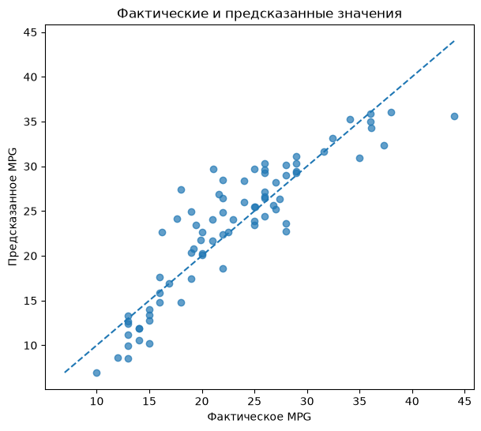
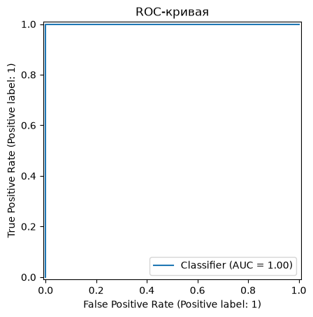

# Практические работы по методам машинного обучения

**ФИО студента:** Белый Максим Сергеевич

**Дисциплина:** Методы машинного обучения

## Описание проекта

Рассмотрены классические алгоритмы машинного обучения и базовые архитектуры нейронных сетей для разных типов данных. В каждом разделе приведены подготовка данных, анализ признаков, обучение и оценка моделей.

[Содержание и результаты](#results) · [Основные графики](#figures) · [Общий вывод](#conclusions)

## Содержание и результаты

### [Практическая работа №1. Классические алгоритмы машинного обучения](Practice_1/README.md)

| Модель | Датасет | Метрики на Test | Графики |
|---|---|---|---:|
| [Линейная регрессия](Practice_1/01_Linear_Regression/README.md) | Auto MPG | MAE = 2.462; RMSE = 3.256; R² = 0.792 | [15](Practice_1/01_Linear_Regression/README.md#figures) |
| [Логистическая регрессия](Practice_1/02_Logistic_Regression/README.md) | Banknote Authentication | Accuracy = 0.985; Precision = 0.968; Recall = 1.000; F1-score = 0.984; ROC-AUC = 1.000 | [16](Practice_1/02_Logistic_Regression/README.md#figures) |
| [Дерево решений](Practice_1/03_Decision_Tree/README.md) | Raisin | Accuracy = 0.872; Precision = 0.832; Recall = 0.933; F1-score = 0.880 | [16](Practice_1/03_Decision_Tree/README.md#figures) |
| [Случайный лес](Practice_1/04_Random_Forest/README.md) | Dry Bean | Accuracy = 0.919; Macro Precision = 0.931; Macro Recall = 0.929; Macro F1-score = 0.930 | [16](Practice_1/04_Random_Forest/README.md#figures) |

### [Практическая работа №2. Базовые архитектуры нейронных сетей](Practice_2/README.md)

| Модель | Датасет | Метрики на Test | Графики |
|---|---|---|---:|
| [Полносвязная сеть (FCN)](Practice_2/01_FCN/README.md) | Pima Indians Diabetes | Accuracy = 0.707; Precision = 0.600; Recall = 0.512; F1-score = 0.553 | [6](Practice_2/01_FCN/README.md#figures) |
| [Сверточная сеть (CNN)](Practice_2/02_CNN/README.md) | Optdigits | Accuracy = 0.853; Macro Precision = 0.859; Macro Recall = 0.852; Macro F1-score = 0.854 | [8](Practice_2/02_CNN/README.md#figures) |
| [Рекуррентная сеть (RNN)](Practice_2/03_RNN/README.md) | Daily Minimum Temperatures | MAE = 1.739; RMSE = 2.236; R² = 0.671 | [7](Practice_2/03_RNN/README.md#figures) |

## Основные графики

### Линейная регрессия

Средняя абсолютная ошибка на тестовой выборке составила 2.462 MPG, RMSE — 3.256 MPG. R² = 0.792. Модель по квадратичной ошибке оказалась лучше прогноза среднего тестовой выборки.

[Разбор графика](Practice_1/01_Linear_Regression/README.md#figure-10)

[Отчёт модели](Practice_1/01_Linear_Regression/README.md) · [Ноутбук](Practice_1/01_Linear_Regression/01_%D0%9B%D0%B8%D0%BD%D0%B5%D0%B9%D0%BD%D0%B0%D1%8F_%D1%80%D0%B5%D0%B3%D1%80%D0%B5%D1%81%D1%81%D0%B8%D1%8F_Auto_MPG.ipynb) · [Практика](Practice_1/README.md#model-01)

### Логистическая регрессия

По матрице ошибок из 270 тестовых объектов правильно классифицировано 266, ошибочно — 4. Accuracy = 0.985. Наименьший Recall получен для класса 0: 0.973.

[Разбор графика](Practice_1/02_Logistic_Regression/README.md#figure-10)

[Отчёт модели](Practice_1/02_Logistic_Regression/README.md) · [Ноутбук](Practice_1/02_Logistic_Regression/02_%D0%9B%D0%BE%D0%B3%D0%B8%D1%81%D1%82%D0%B8%D1%87%D0%B5%D1%81%D0%BA%D0%B0%D1%8F_%D1%80%D0%B5%D0%B3%D1%80%D0%B5%D1%81%D1%81%D0%B8%D1%8F_Banknote.ipynb) · [Практика](Practice_1/README.md#model-02)

### Дерево решений

По матрице ошибок из 180 тестовых объектов правильно классифицировано 157, ошибочно — 23. Accuracy = 0.872. Наименьший Recall получен для класса Besni: 0.811.

[Разбор графика](Practice_1/03_Decision_Tree/README.md#figure-09)

[Отчёт модели](Practice_1/03_Decision_Tree/README.md) · [Ноутбук](Practice_1/03_Decision_Tree/03_%D0%94%D0%B5%D1%80%D0%B5%D0%B2%D0%BE_%D1%80%D0%B5%D1%88%D0%B5%D0%BD%D0%B8%D0%B9_Raisin.ipynb) · [Практика](Practice_1/README.md#model-03)

### Случайный лес

По матрице ошибок из 2709 тестовых объектов правильно классифицировано 2490, ошибочно — 219. Accuracy = 0.919. Наименьший Recall получен для класса SIRA: 0.858.

[Разбор графика](Practice_1/04_Random_Forest/README.md#figure-09)

[Отчёт модели](Practice_1/04_Random_Forest/README.md) · [Ноутбук](Practice_1/04_Random_Forest/04_%D0%A1%D0%BB%D1%83%D1%87%D0%B0%D0%B9%D0%BD%D1%8B%D0%B9_%D0%BB%D0%B5%D1%81_Dry_Bean.ipynb) · [Практика](Practice_1/README.md#model-04)

### Полносвязная сеть (FCN)

По матрице ошибок из 116 тестовых объектов правильно классифицировано 82, ошибочно — 34. Accuracy = 0.707. Наименьший Recall получен для класса 1: 0.512.

[Разбор графика](Practice_2/01_FCN/README.md#figure-06)

[Отчёт модели](Practice_2/01_FCN/README.md) · [Ноутбук](Practice_2/01_FCN/01_fcn_numpy_JupyterLite.ipynb) · [Практика](Practice_2/README.md#model-01)

### Сверточная сеть (CNN)

По матрице ошибок из 1797 тестовых объектов правильно классифицировано 1532, ошибочно — 265. Accuracy = 0.853. Наименьший Recall получен для класса 8: 0.741.

[Разбор графика](Practice_2/02_CNN/README.md#figure-07)

[Отчёт модели](Practice_2/02_CNN/README.md) · [Ноутбук](Practice_2/02_CNN/02_cnn_numpy_JupyterLite.ipynb) · [Практика](Practice_2/README.md#model-02)

### Рекуррентная сеть (RNN)

Средняя абсолютная ошибка на тестовой выборке составила 1.739 °C, RMSE — 2.236 °C. R² = 0.671. Модель по квадратичной ошибке оказалась лучше прогноза среднего тестовой выборки.

[Разбор графика](Practice_2/03_RNN/README.md#figure-07)

[Отчёт модели](Practice_2/03_RNN/README.md) · [Ноутбук](Practice_2/03_RNN/03_rnn_numpy_JupyterLite.ipynb) · [Практика](Practice_2/README.md#model-03)

## Общий вывод

Результаты разных моделей получены на разных наборах данных. Значения метрик характеризуют качество решения соответствующей задачи и не являются прямым рейтингом алгоритмов. Графики и численные показатели рассмотрены совместно.

## Используемые инструменты

Python, Jupyter Notebook, NumPy, Pandas, Matplotlib, Seaborn, SciPy, Scikit-learn. Нейронные сети реализованы на NumPy.

## Просмотр работ

README каждого уровня содержит ссылки на соответствующие разделы. Полный набор графиков, пояснения и метрики расположены в отчёте каждой модели.
